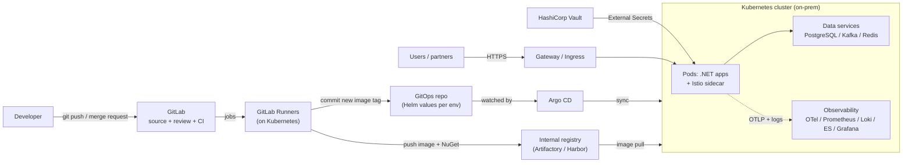

# On-Prem .NET on Kubernetes: A Complete Platform Guide

A from-scratch, vendor-documentation-backed guide to building a **fully on-premises delivery and runtime platform for containerised .NET applications**: GitLab for source and CI, an internal registry, Argo CD for GitOps deployment, Kubernetes for runtime, Istio for the service mesh, HashiCorp Vault for secrets, PostgreSQL / Kafka / Redis running on Kubernetes, and a full observability stack (OpenTelemetry, Prometheus, Loki, Elasticsearch, Tempo, Grafana).

It is written for a small team (a startup, or a platform team of 2-4 people) that has a clean slate and wants to know **what to install, in what order, and why**.

> **Status of the examples.** Manifests and pipelines in this guide are illustrative. They were written against current upstream documentation but have **not** been applied to a live cluster by the author. Operator CRD versions change; always check the version your installed operator serves (`kubectl explain`, `kubectl api-resources`) before copying.

---

## The platform at a glance

---

## How to read this guide

Read in order if you are building from zero. Each chapter ends with a "done when" checklist so you know you can move on.

| # | Chapter | What you will have at the end |
|---|---|---|
| 1 | [Architecture and planning](docs/01-architecture-and-planning.md) | Target architecture, sizing, environments, decisions to make up front, build order |
| 2 | [Cluster foundation](docs/02-cluster-foundation.md) | A highly available on-prem Kubernetes cluster with networking, storage, certificates, ingress |
| 3 | [GitLab](docs/03-gitlab.md) | GitLab installed, runners on Kubernetes, groups, branch protection, code review rules, AI-assisted review |
| 4 | [CI pipelines: YAML deep dive](docs/04-ci-pipelines.md) | Complete `.gitlab-ci.yml` syntax reference and a production .NET pipeline |
| 5 | [Registry and artifacts](docs/05-registry-and-artifacts.md) | Internal Docker registry and NuGet feed, promotion, retention, supply-chain controls |
| 6 | [.NET containers and Kubernetes workloads](docs/06-dotnet-containers-and-k8s.md) | Hardened Dockerfile, Helm chart, Deployment, probes, autoscaling |
| 7 | [Argo CD and GitOps](docs/07-argocd-gitops.md) | Pull-based deployment, environment promotion, rollout and deployment monitoring |
| 8 | [Data services on Kubernetes](docs/08-data-services.md) | PostgreSQL, Kafka and Redis running on the cluster with backups and monitoring |
| 9 | [Vault and secrets](docs/09-vault-and-secrets.md) | Vault HA on Kubernetes, pod and CI authentication, External Secrets, dynamic DB credentials |
| 10 | [Istio service mesh](docs/10-istio-service-mesh.md) | mTLS, authorisation policy, gateways, traffic management |
| 11 | [Observability](docs/11-observability.md) | OpenTelemetry, Prometheus, Loki, Elasticsearch, Tempo and Grafana dashboards and alerts |
| 12 | [Operations, security, DR](docs/12-operations-security-dr.md) | Backups, upgrades, hardening checklist, troubleshooting runbook |
| 13 | [Sources and verification notes](docs/13-sources.md) | What was checked against official documentation, and what was not |

---

## Core principles

1. **Git is the source of truth.** Application code, pipeline definitions, Helm values and cluster add-on configuration all live in Git and change through reviewed merge requests.
2. **CI builds; Argo CD deploys.** CI never holds cluster-admin credentials. The cluster pulls its own desired state.
3. **Immutable artifacts.** Build once, tag by commit SHA, promote the same digest through environments. Never deploy `:latest`.
4. **No long-lived secrets in Git, images or CI variables** when a runtime fetch from Vault is possible.
5. **Observability from day one.** Logs, metrics and traces are part of the definition of done for any service, not a later phase.
6. **Start simple, add weight when it pays.** A service mesh, a second logging backend, or operator-managed Kafka each carry operating cost. The roadmap in chapter 1 orders them by value.

## Technology choices used in this guide

These are defaults, each with alternatives discussed in the relevant chapter.

| Concern | Default in this guide | Alternatives |
|---|---|---|
| Kubernetes distribution | kubeadm-style upstream or RKE2 | Talos, k3s (small), OpenShift (commercial) |
| CNI | Cilium | Calico |
| Load balancer (bare metal) | MetalLB | kube-vip, Cilium LB-IPAM |
| Storage | Rook-Ceph | Longhorn, local PVs for databases |
| Ingress / edge | Gateway API (Istio or Envoy Gateway) | Traefik, HAProxy Ingress |
| Source control + CI | GitLab (self-managed) | - |
| Registry | Harbor or JFrog Artifactory (Pro+) | Nexus, GitLab Container Registry |
| GitOps | Argo CD | Flux |
| Secrets | HashiCorp Vault + External Secrets Operator | OpenBao, Vault Secrets Operator |
| PostgreSQL on K8s | CloudNativePG | Zalando operator, Crunchy PGO |
| Kafka on K8s | Strimzi (KRaft mode) | Confluent for Kubernetes |
| Redis on K8s | Operator-managed Redis or Valkey | Plain StatefulSet for cache-only |
| Telemetry | OpenTelemetry (Operator + Collector) | Vendor agents |
| Metrics | Prometheus (kube-prometheus-stack) | VictoriaMetrics, Mimir |
| Logs | Loki (default) and Elasticsearch (search/audit) | Either alone |
| Traces | Tempo | Jaeger |
| Dashboards | Grafana | - |

## Licence and use

Documentation text is intended to be freely reusable; add the licence of your choice (for example CC BY 4.0 for the prose and MIT for code samples) before publishing.
