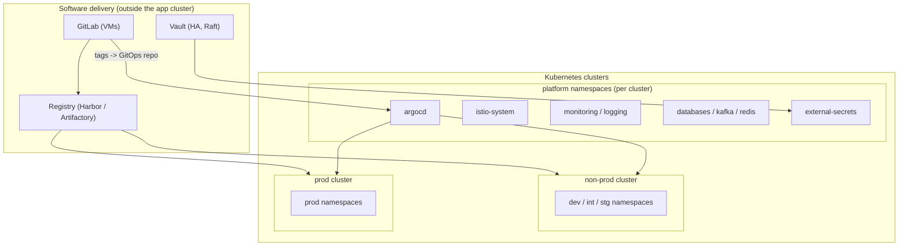
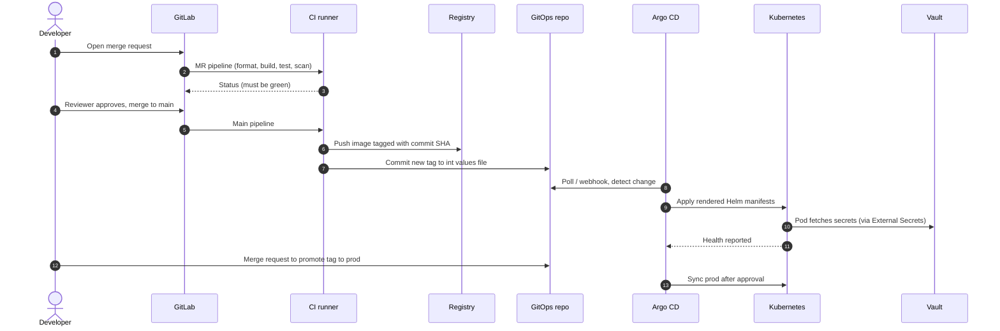
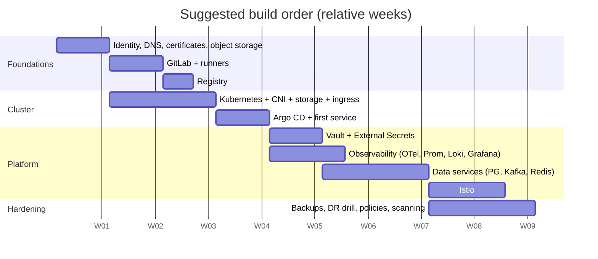

# 1. Architecture and planning

## 1.1 Goals and non-goals

**Goals**

- Developers merge a reviewed change and, minutes later, see it running in a non-production environment with no manual steps.
- Production changes are a reviewed Git commit, with an audit trail and a one-step rollback.
- The whole platform runs inside your own data centre or co-location: no mandatory public cloud services.
- Secrets, logs, metrics and traces are handled consistently for every service.

**Non-goals**

- Multi-region active-active. This guide covers one site with a documented path to a second site for disaster recovery.
- Replacing every managed service. Running PostgreSQL and Kafka on Kubernetes is possible and covered, but chapter 8 is explicit about when a dedicated VM is the better home.

## 1.2 Logical architecture



### Why GitLab, the registry and Vault sit *outside* the app cluster

If your delivery tooling runs inside the cluster it deploys to, a cluster outage also takes out the means to repair it. Putting GitLab, the registry and Vault on separate VMs (or a small separate "tools" cluster) means you can always rebuild the app cluster from Git and pull images from the registry. This is the single most useful structural decision for a small team.

## 1.3 The delivery flow end to end



## 1.4 Environments

| Environment | Purpose | Deploy trigger | Data |
|---|---|---|---|
| `sandbox` | Feature branches, short TTL | Manual or on-demand from a branch | Synthetic |
| `dev` | Integration of merged work | Automatic on merge to `main` | Synthetic |
| `stg` | Production-like, release candidates | Automatic after dev gates | Masked copy or synthetic at scale |
| `prod` | Customers | Merge request in GitOps repo (approved) | Real |

Recommendation: **two clusters** (non-prod and prod) for a startup. Use namespaces for dev/int/stg inside the non-prod cluster. A single cluster for everything is workable at the very start but couples upgrade risk to production.

## 1.5 Sizing starting point

Treat these as a starting estimate, then measure.

| Component | Nodes | Per-node sizing (starting point) | Notes |
|---|---|---|---|
| Kubernetes control plane | 3 | 4 vCPU, 8 GB RAM, SSD | Odd number for etcd quorum |
| Kubernetes workers (non-prod) | 3-5 | 8 vCPU, 32 GB | Add as workloads grow |
| Kubernetes workers (prod) | 5+ | 8-16 vCPU, 32-64 GB | Spread across failure domains |
| Storage nodes (Ceph) | 3+ | 8 vCPU, 32 GB, dedicated NVMe/SSD OSDs | Separate network if possible |
| GitLab | 1-2 VMs | 8 vCPU, 16-32 GB | Check GitLab reference architectures for your user count |
| Registry | 1-2 VMs | 4 vCPU, 8 GB + large disk or object storage | Back it with object storage |
| Vault | 3 VMs or pods | 2-4 vCPU, 4-8 GB | Raft needs fast disk |

## 1.6 Decisions to make before you build

| Decision | Options | Recommendation |
|---|---|---|
| Where Kubernetes runs | Bare metal, VMs on a hypervisor | VMs on a hypervisor are simpler to snapshot and replace; bare metal gives performance for storage/Kafka nodes |
| Distribution | Upstream kubeadm, RKE2, Talos | RKE2 or Talos for fewer moving parts; kubeadm if you want maximum control |
| Edge | Hardware or virtual load balancer + MetalLB | Fixed VIP for API server and one for ingress |
| Identity provider | LDAP/AD, Keycloak, Entra ID | One IdP for GitLab, Argo CD, Grafana, Vault (OIDC) |
| DNS and certificates | Internal CA vs ACME | Internal CA via cert-manager; ACME only for externally reachable names |
| Object storage | Ceph RGW, MinIO, appliance | Needed for registry blobs, backups, Loki, Tempo |
| Where data services run | In cluster (operators) or on VMs | Start with operators for non-prod; decide prod per service (chapter 8) |

## 1.7 Naming and layout conventions

Adopt these once, early.

```text
Domains         gitlab.acme.internal   registry.acme.internal   vault.acme.internal
                argocd.acme.internal   grafana.acme.internal
Namespaces      <team>-<env>   e.g. orders-dev, orders-prod ; platform ones: argocd, monitoring, logging
Image names     registry.acme.internal/<team>/<service>:<git-sha>
Helm releases   <service> in namespace <team>-<env>
Vault paths     kv/<team>/<env>/<service>/...
Labels          app.kubernetes.io/name, /instance, /version, /part-of, team, env
Git repos       services/<service>      platform/gitops      platform/pipeline-templates
```

## 1.8 Build order (roadmap)



Order rationale: source control and CI first because everything else is code; observability **before** the heavy data services and mesh so you can see them misbehave; Istio last because it is easiest to add to a healthy system and hardest to debug in an unhealthy one.

## 1.9 Team and ownership

- **Platform owner** (can be part-time): shared pipeline templates, base Helm chart, cluster add-ons, Vault policies, Argo CD.
- **Service teams**: their service repo, the short CI file, Helm values, dashboards and alerts.
- Write down who may change what. Most outages in this kind of stack are permission or ownership confusion rather than tool faults.

## Done when

- [ ] Architecture diagram agreed and stored in the platform repo.
- [ ] Domain names, namespaces, labels and Vault path conventions written down.
- [ ] Decision made on one vs two clusters and where GitLab, registry and Vault run.
- [ ] Identity provider chosen.
