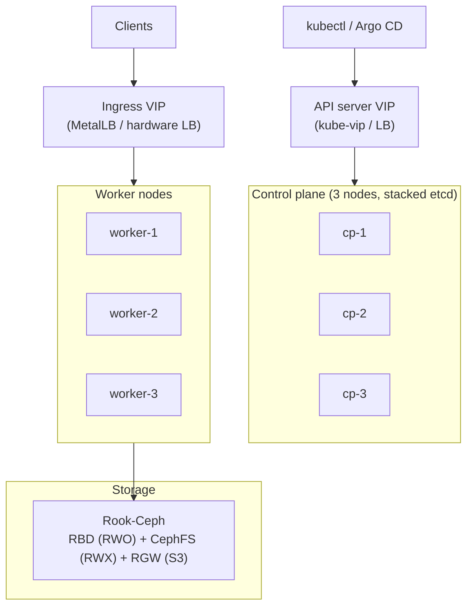

# 2. Cluster foundation (on-prem Kubernetes)

## 2.1 Topology



## 2.2 Choosing a distribution

| Option | Strengths | Trade-offs |
|---|---|---|
| **kubeadm (upstream)** | Full control, closest to upstream docs | You manage OS, etcd backup, upgrades and certificates yourself |
| **RKE2** | Hardened defaults, simple install, built-in etcd snapshots | Vendor-flavoured; follow its upgrade channels |
| **Talos Linux** | Immutable, API-managed OS, very small attack surface | Different operating model (no SSH); learning curve |
| **k3s** | Lightweight, quick | Better for edge/small; check HA and storage story for production |

Whichever you choose: three control-plane nodes, a virtual IP in front of the API server, automated etcd snapshots shipped off the node, and a documented upgrade procedure tested in non-prod first.

## 2.3 Node preparation checklist

- Time sync (chrony) on every node; certificates and Kerberos-style logins break silently on skew.
- Swap off (or follow the Kubernetes swap guidance for your version).
- Container runtime: containerd.
- Kernel modules and sysctls required by your CNI.
- Separate disks for etcd (control plane) and for Ceph OSDs.
- Static IPs and forward/reverse DNS for all nodes.

## 2.4 Networking

### CNI

Cilium or Calico are the mainstream choices. Pick one that supports **NetworkPolicy** (both do) because default-deny policies are part of the hardening in chapter 12.

### Bare-metal load balancing with MetalLB

Kubernetes `Service` of type `LoadBalancer` has no implementation on bare metal until you add one. MetalLB announces addresses from a pool using Layer 2 (ARP/NDP) or BGP.

```yaml
apiVersion: metallb.io/v1beta1
kind: IPAddressPool
metadata: { name: edge, namespace: metallb-system }
spec:
  addresses: [ "10.20.30.200-10.20.30.220" ]
---
apiVersion: metallb.io/v1beta1
kind: L2Advertisement
metadata: { name: edge, namespace: metallb-system }
spec: { ipAddressPools: [ edge ] }
```

Use BGP if your network team can peer with the cluster; it removes the single-active-node limitation of L2 mode.

### Ingress and the Gateway API

> **Important.** The Kubernetes project announced the retirement of the community **ingress-nginx** controller, with best-effort maintenance ending in **March 2026** and no further releases or security fixes after that ([Kubernetes blog, Nov 2025](https://www.kubernetes.io/blog/2025/11/11/ingress-nginx-retirement/); [steering statement, Jan 2026](https://www.kubernetes.io/blog/2026/01/29/ingress-nginx-statement/)). The `Ingress` API itself is not being removed, but the project recommends evaluating the **Gateway API**. For a new build, do not start on ingress-nginx.

Options for the edge:

| Option | When to choose |
|---|---|
| **Istio gateway** (Gateway API) | You are adopting Istio anyway (chapter 10): one component for edge and mesh |
| **Envoy Gateway** | Gateway API-native edge without a service mesh |
| **Traefik** or **HAProxy Ingress** | You want a mature Ingress controller with simple operations |
| **Cilium Gateway API** | You already run Cilium and want fewer components |

Minimal Gateway API shape (controller-agnostic):

```yaml
apiVersion: gateway.networking.k8s.io/v1
kind: Gateway
metadata: { name: public, namespace: edge }
spec:
  gatewayClassName: <your-gateway-class>
  listeners:
  - name: https
    port: 443
    protocol: HTTPS
    hostname: "*.acme.internal"
    tls: { mode: Terminate, certificateRefs: [ { name: wildcard-acme-internal } ] }
    allowedRoutes: { namespaces: { from: All } }
---
apiVersion: gateway.networking.k8s.io/v1
kind: HTTPRoute
metadata: { name: orders-api, namespace: orders-prod }
spec:
  parentRefs: [ { name: public, namespace: edge } ]
  hostnames: [ "orders.acme.internal" ]
  rules:
  - backendRefs: [ { name: orders-api, port: 80 } ]
```

## 2.5 Certificates with cert-manager

cert-manager issues and renews certificates as Kubernetes resources. On-prem you typically use an **internal CA** (self-managed, or Vault's PKI engine, chapter 9) rather than a public ACME CA.

```yaml
apiVersion: cert-manager.io/v1
kind: ClusterIssuer
metadata: { name: internal-ca }
spec:
  ca: { secretName: internal-ca-keypair }     # CA key pair stored as a Secret in cert-manager's namespace
---
apiVersion: cert-manager.io/v1
kind: Certificate
metadata: { name: wildcard-acme-internal, namespace: edge }
spec:
  secretName: wildcard-acme-internal
  issuerRef: { name: internal-ca, kind: ClusterIssuer }
  dnsNames: [ "*.acme.internal" ]
```

Distribute your internal CA certificate to every node's trust store and to your build images, otherwise registry pulls and `git clone` over HTTPS will fail certificate validation.

## 2.6 Storage

Stateful workloads (databases, Kafka, Elasticsearch, Loki, Prometheus, Vault) need dependable persistent volumes.

| Option | Pros | Cons |
|---|---|---|
| **Rook-Ceph** | Block (RWO), shared filesystem (RWX), S3-compatible object store (RGW) from one system | Operationally heavy; needs 3+ nodes and good disks/network |
| **Longhorn** | Simpler to run, built-in snapshots/backup to S3/NFS | Less performant for heavy I/O; know its failure modes |
| **Local PVs (topolvm, local-path)** | Best latency; databases that replicate themselves (PostgreSQL, Kafka) do not need replicated storage | Data tied to a node; node loss needs replica rebuild |

Guidance: use replicated block storage for general workloads; consider **local NVMe** for Kafka brokers and PostgreSQL primaries *when the application layer already replicates* (Kafka partitions, PostgreSQL streaming replicas), because double replication wastes capacity and adds latency.

Define at least two StorageClasses, for example `fast-rwo` (SSD-backed) and `bulk` (HDD or erasure-coded), and set reclaim policy and volume expansion deliberately.

## 2.7 Cluster add-ons installed up front

| Add-on | Why |
|---|---|
| metrics-server | HPA and `kubectl top` |
| cert-manager | Certificates |
| MetalLB | LoadBalancer IPs |
| CSI driver (Rook-Ceph) + snapshot controller | Volumes and snapshots |
| external-dns (optional) | DNS records from Services/Routes |
| Velero (or equivalent) | Namespace and volume backup |
| Kyverno or Gatekeeper | Policy as code (no `latest`, require limits, block privileged) |
| Reloader | Roll pods when ConfigMaps/Secrets change |

Install all add-ons **through Argo CD** once it exists (chapter 7). Before that, install Argo CD itself by hand and let it adopt the rest.

## 2.8 Namespace and quota baseline

```yaml
apiVersion: v1
kind: Namespace
metadata:
  name: orders-prod
  labels:
    pod-security.kubernetes.io/enforce: restricted
    istio-injection: enabled          # only after chapter 10
---
apiVersion: v1
kind: ResourceQuota
metadata: { name: default, namespace: orders-prod }
spec:
  hard: { requests.cpu: "20", requests.memory: 40Gi, limits.memory: 80Gi, persistentvolumeclaims: "20" }
---
apiVersion: networking.k8s.io/v1
kind: NetworkPolicy
metadata: { name: default-deny-ingress, namespace: orders-prod }
spec: { podSelector: {}, policyTypes: [ Ingress ] }
```

## Done when

- [ ] Three control-plane nodes, API VIP reachable, etcd snapshots verified restorable.
- [ ] Workers join; a test Deployment gets a `LoadBalancer` IP and a trusted HTTPS certificate.
- [ ] A test PVC binds and survives a pod reschedule.
- [ ] Node drain and upgrade rehearsed once.
