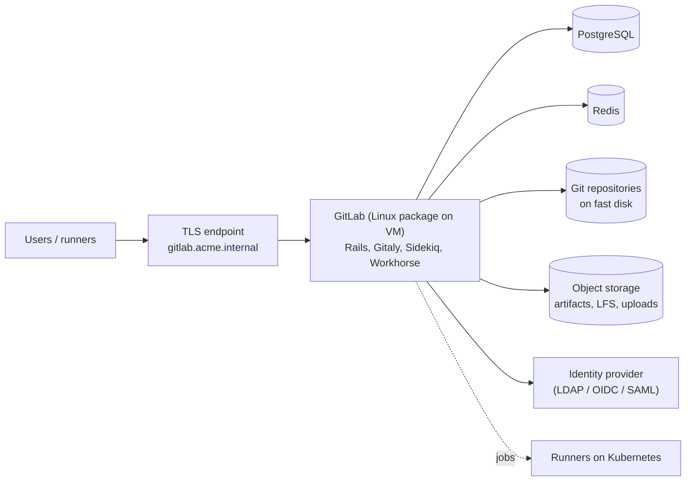
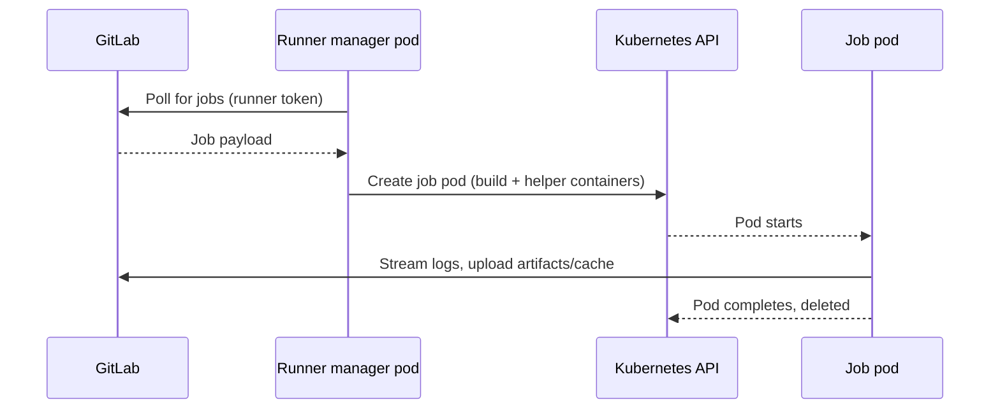

# 3. GitLab: source control, runners, review rules

## 3.1 What GitLab gives you

A single application covering Git hosting, merge requests and review, CI/CD, a container registry, a package registry (including NuGet), security scanning, and issue tracking. For an on-prem startup the practical question is how much of it to adopt. This guide uses GitLab for **source, review and CI**, and a dedicated registry (chapter 5) for artifacts; GitLab's built-in registries are a valid simpler start.

## 3.2 Installing self-managed GitLab



| Installation | When to use |
|---|---|
| **Linux package (Omnibus) on a VM** | Default for small and medium teams: simple to back up and upgrade, and it stays outside your app cluster |
| **Helm chart on Kubernetes** | Larger scale or if you already have a dedicated tools cluster; stateful parts (Gitaly, PostgreSQL) still need care |

Check GitLab's **reference architectures** for the sizing that matches your user count and request rate, and follow its supported upgrade paths (upgrade through required stops, never skip).

Essentials after install:

- Terminate TLS with your internal CA; set `external_url`.
- Connect your identity provider (LDAP or OIDC/SAML); enforce two-factor authentication.
- Configure **object storage** for artifacts, LFS and uploads so the VM disk is not the only copy.
- Schedule `gitlab-backup` **and** back up the configuration/secrets files separately (the backup is unusable without the secrets file). Test a restore.
- Configure outbound SMTP and, if the instance has no internet, a package/mirror strategy for CI base images.

## 3.3 Group and project structure

```text
acme/                           top-level group: SSO, 2FA, default protections
  platform/
    pipeline-templates          shared CI templates / components
    gitops                      Helm values + Argo CD Application manifests
    helm-charts                 base chart(s) for .NET services
    infra                       cluster add-on configuration
  services/
    orders-api
    payments-worker
    ...
```

Group-level settings (approval rules, CI/CD variables, protected branches defaults) are inherited by projects, so set organisation-wide policy once.

## 3.4 Runners on Kubernetes

A GitLab **Runner** executes CI jobs. The Kubernetes executor starts one pod per job in a namespace you control, so capacity scales with the cluster and each job is isolated and ephemeral.



```yaml
# values for the gitlab-runner Helm chart (shape only)
gitlabUrl: https://gitlab.acme.internal/
runners:
  config: |
    [[runners]]
      [runners.kubernetes]
        namespace = "ci-jobs"
        image = "registry.acme.internal/base/dotnet-sdk:10.0"
        cpu_request = "500m"
        memory_request = "1Gi"
        service_account = "ci-job"
rbac: { create: true }
```

Runner guidance:

- **Separate trust tiers.** One runner pool for protected branches/tags (can use protected variables), another for merge requests from less-trusted contributors.
- **No shared Docker socket.** Build images with a rootless, daemonless builder (Buildah, Podman, or a BuildKit-based rootless setup). Check the maintenance status of whichever builder you pick.
- Give job pods a minimal service account; deployments are Argo CD's job, not the runner's.
- Cache NuGet packages with a distributed cache (S3-compatible) so autoscaled pods benefit from each other's downloads.
- Add your internal CA certificate to job images.

## 3.5 Branching model and protection

- Trunk-based: one long-lived default branch (`main`), short-lived feature branches, **squash merge**, linear history.
- Releases are tags (SemVer) cut from `main`.
- Protect `main`: no direct pushes, merge only via merge request, force-push disabled.
- Project settings to enable: **Pipelines must succeed**, **All threads must be resolved**, merge request pipelines on, optionally **merge trains** so that `main` stays green when several merges queue up.

## 3.6 Code review rules

### Mechanisms GitLab provides

| Mechanism | Behaviour |
|---|---|
| **Approval rules** | Require N approvals per rule, per protected branch. Defaults at project/group level or per merge request. Authors cannot approve their own MR by default (committers can). Multiple rules stack; one approval counts toward every rule the approver belongs to |
| **CODEOWNERS** | Owners of changed paths become eligible approvers; combine with "require code owner approval" on protected branches |
| **Push rules** | Reject commits by message pattern, file name (for example `*.pem`, `*.pfx`), file size, or author email domain |
| **Required pipeline success** | Merge is blocked while CI is red |
| **Resolve-all-threads** | Merge blocked while discussions are open |
| **Merge request pipelines / trains** | Test the result of merging, not only the branch |

### A review policy that suits a startup

- **One** non-author approval for application repos; **two** for the platform repos (pipeline templates, GitOps repo, Helm charts) because their blast radius is every service.
- A CODEOWNERS file in every repo. Platform owners must review pipeline files, Dockerfiles, Helm values and database migrations.
- Small merge requests (aim under ~400 changed lines), with a test plan and a linked issue.
- No self-approval and no bypass for admins. A documented break-glass procedure exists instead of a habit.
- Mandatory automated gates before a human looks: format, build, unit tests, SAST, secret detection, dependency scan, quality gate (for example SonarQube).

```text
# CODEOWNERS (example)
*                         @acme/services/orders-reviewers
/.gitlab-ci.yml           @acme/platform
Dockerfile                @acme/platform
helm/                     @acme/platform @acme/services/orders-reviewers
**/Migrations/            @acme/dba @acme/services/orders-reviewers
```

## 3.7 AI-assisted code review

GitLab Duo can be requested on a merge request (mention `@GitLabDuo`). Per GitLab's documentation there are two review features:

- **Code Review Flow**: an agentic review that considers repository structure and cross-file dependencies; it consumes GitLab credits and does not need the Enterprise add-on.
- **GitLab Duo Code Review**: a single-pass review of the merge request diff; requires an Enterprise seat.

Other Duo features in merge requests (description generation, review summary, commit message generation) are in different maturity levels (some Beta or Experiment) and different tiers. Check tier, add-on and billing before relying on a feature. Also check the **data-handling terms**, because diffs or file contents are sent to a model, and self-managed instances without internet access may need an AI gateway arrangement.

**Where AI fits**

- First-pass review for likely bugs: missing null handling, async misuse (`.Result`, `.Wait()`), N+1 queries, missing tests.
- Summarising large merge requests and drafting descriptions.

**Where it does not**

- It does not replace the approval rule. Keep a human approver; AI feedback is advisory.
- It does not enforce standards durably. Encode standards in deterministic tools first: `.editorconfig`, Roslyn analyzers with `TreatWarningsAsErrors`, `dotnet format --verify-no-changes`, quality gates.

**Do-it-yourself option (fully on-prem model).** A non-blocking CI job that sends the merge request diff to an internally hosted model and posts findings as an MR note. Treat it as a custom integration you own:

```yaml
ai-review:
  stage: verify
  image: registry.acme.internal/tools/ci-utils:1.0
  rules:
    - if: $CI_PIPELINE_SOURCE == "merge_request_event"
  allow_failure: true               # advisory only
  script:
    - git diff --unified=3 "origin/$CI_MERGE_REQUEST_TARGET_BRANCH_NAME...HEAD" | head -c 60000 > diff.patch
    - ./scripts/post-ai-review.sh diff.patch     # calls your internal model endpoint, posts an MR note
```

Cap diff size, strip secrets, and log what leaves the process.

## 3.8 Security features worth enabling

| Feature | Notes |
|---|---|
| Secret detection | Run in pipelines; add push rules blocking key/cert files |
| SAST, dependency scanning, container scanning | Available as templates; some features depend on tier |
| Protected and masked CI/CD variables | Protected = only on protected refs; masked = redacted in logs |
| Audit events | Retain and ship to your logging stack |
| Deploy tokens / project access tokens | Scope narrowly, give expiry dates |

## Done when

- [ ] GitLab reachable over trusted TLS, SSO + 2FA enforced, backup **and restore** tested.
- [ ] Groups and baseline protections created at the top-level group.
- [ ] A runner pool on Kubernetes runs a "hello world" job in an isolated pod.
- [ ] A test merge request cannot merge without an approval and a green pipeline.
