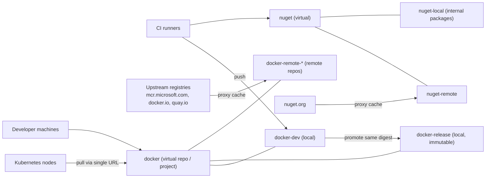

# 5. Internal registry and artifact management

You need a place to store **container images** and **NuGet packages** that is private, fast, backed up, and under your control. On-prem it also acts as a **supply-chain choke point**: base images and third-party packages are pulled from the internet once, vetted, and then served internally.



## 5.1 Product choice

| Option | Docker/OCI | NuGet | Notes |
|---|---|---|---|
| **JFrog Artifactory (Pro / Enterprise tiers)** | Yes | Yes, plus 30+ other package types | One system for every package type; local, remote (proxy) and virtual repositories. Licensed. |
| **JFrog Artifactory OSS** | **No** | No | Search results and JFrog documentation indicate the OSS edition targets Maven/Gradle-type repositories and does not include Docker; confirm against JFrog's current edition comparison before relying on it |
| **Harbor** (CNCF graduated) | Yes (images and OCI artifacts, Helm OCI) | No | Free; vulnerability scanning, signing, replication, robot accounts, proxy cache projects |
| **Sonatype Nexus Repository** | Yes | Yes | Multi-format; check which features are in the community edition |
| **GitLab Container + Package Registry** | Yes | Yes | Built in; the lowest-effort start for a small team |

Recommendation for a startup: **GitLab's built-in registries first** (zero extra systems), or **Harbor** for images if you want scanning/replication/proxy cache, adding a package manager (Artifactory/Nexus) when you need multi-format proxying or governance. Choose Artifactory when you are already buying it or need one tool across .NET, npm, Maven and containers.

## 5.2 Repository model (Artifactory terminology; Harbor and Nexus map closely)

| Type | What it is | Example |
|---|---|---|
| **Local** | You push your own artifacts | `docker-dev`, `docker-release`, `nuget-local` |
| **Remote** | Caching proxy of an upstream | `docker-remote-mcr` (mcr.microsoft.com), `nuget-remote` (nuget.org) |
| **Virtual** | One URL aggregating local + remote | `docker`, `nuget` |

Suggested layout:

| Repository | Type | Purpose |
|---|---|---|
| `docker-base` | Local | Curated, approved base images (`dotnet-sdk`, `aspnet`, `ci-utils`) |
| `docker-remote-mcr` | Remote | Proxy `mcr.microsoft.com` |
| `docker-dev` | Local | Every `main` build; short retention |
| `docker-release` | Local | Promoted images only; immutable; long retention |
| `docker` | Virtual | Single pull URL for developers and clusters |
| `nuget-local` | Local | Internal packages |
| `nuget-remote` | Remote | Proxy nuget.org |
| `nuget` | Virtual | Single feed URL for restore |

## 5.3 Practices that matter

1. **Promote, don't rebuild.** Build once into `docker-dev`. After gates pass, promote the **same digest** to `docker-release`. Promoted bits equal tested bits.
2. **Immutable tags** in release repositories. Never overwrite; never deploy `:latest`.
3. **Mirror base images.** Pull `dotnet/sdk` and `dotnet/aspnet` into your own base repository; rebuild them on a schedule (OS patches) and scan them. Teams then `FROM registry.acme.internal/docker-base/aspnet:10.0`.
4. **Retention.** Dev images: keep the last N or 14-30 days. Release images: keep per policy. Unbounded registries are the commonest cost surprise.
5. **Authentication.** CI uses scoped, short-lived tokens (robot accounts); clusters use `imagePullSecrets` per namespace; humans use SSO. Do not use the admin account for automation.
6. **Back it up.** Registry database plus blob store (object storage with versioning/replication). Practise a restore.
7. **Scan and sign.** Run vulnerability scans on push; consider signing images (Cosign/Sigstore) and enforcing signatures with an admission policy.
8. **Pin and lock NuGet.** Use central package management (`Directory.Packages.props`), commit `packages.lock.json`, restore with `--locked-mode`.
9. **Treat package versions as a public API.** When an internal NuGet package contains message or contract models shared by several services, a change is breaking until every consumer bumps. Use SemVer and a compatibility policy.

## 5.4 Docker flows

Login, build and push (illustrative; CI should use rootless tooling and tokens):

```bash
docker login registry.acme.internal
docker build -t registry.acme.internal/orders/orders-api:3f9c2ab --build-arg version=3f9c2ab .
docker push registry.acme.internal/orders/orders-api:3f9c2ab
```

Kubernetes pull secret:

```bash
kubectl -n orders-prod create secret docker-registry regcred \
  --docker-server=registry.acme.internal \
  --docker-username=<robot-account> --docker-password=<token>
```

```yaml
# attach to the namespace's default service account
apiVersion: v1
kind: ServiceAccount
metadata: { name: default, namespace: orders-prod }
imagePullSecrets: [ { name: regcred } ]
```

Better: create the pull secret from Vault with External Secrets (chapter 9) instead of by hand.

Registry trust: every node's container runtime and every CI job image must trust your internal CA. For containerd, place the CA under `/etc/containerd/certs.d/registry.acme.internal/` and reference it in `hosts.toml`.

## 5.5 NuGet flows

```bash
# restore through the virtual feed
dotnet nuget add source https://registry.acme.internal/artifactory/api/nuget/v3/nuget --name acme

# publish an internal package
dotnet pack -c Release -p:Version=1.4.2 -o nupkg
dotnet nuget push "nupkg/*.nupkg" --source acme --api-key "$NUGET_API_KEY"
```

(The feed URL shape differs by product; Harbor does not host NuGet.)

`nuget.config` with package source mapping (restrict which source may supply which package IDs: mitigates dependency-confusion attacks):

```xml
<configuration>
  <packageSources>
    <clear />
    <add key="acme" value="https://registry.acme.internal/artifactory/api/nuget/v3/nuget" />
  </packageSources>
  <packageSourceMapping>
    <packageSource key="acme">
      <package pattern="Acme.*" />
      <package pattern="*" />
    </packageSource>
  </packageSourceMapping>
</configuration>
```

## 5.6 Capacity and operations

- Plan blob storage growth: image layers dominate. Garbage-collect untagged layers on a schedule.
- Put the registry behind TLS with a certificate from your internal CA, and monitor disk, GC jobs and 5xx rate.
- For disaster recovery, replicate the registry (Harbor replication, Artifactory federated/replication) to a second site.

## Done when

- [ ] CI can push images and packages; clusters can pull via a single URL and trusted TLS.
- [ ] Base images mirrored and scanned; `FROM` lines point at your own registry.
- [ ] Retention and immutable-release rules configured.
- [ ] A restore from backup has been rehearsed.
