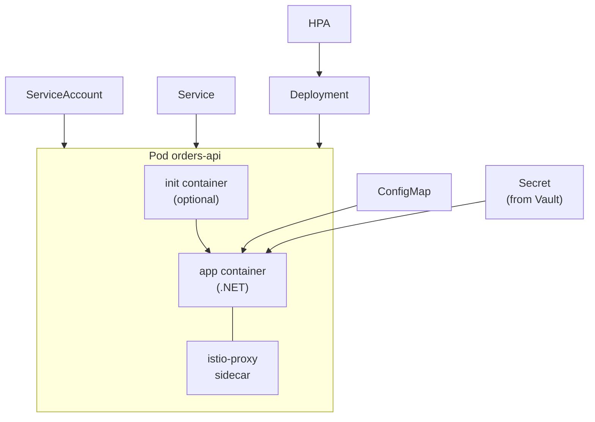

# 6. .NET containers and Kubernetes workloads

## 6.1 Container images for .NET

### Two build strategies

| Strategy | How | Trade-off |
|---|---|---|
| **A. Publish in CI, package in Docker** | CI runs `dotnet restore/test/publish`; the Dockerfile only does `COPY` onto the runtime image | Fast; reuses CI test results and caches; the Dockerfile alone cannot rebuild the app |
| **B. Multi-stage Dockerfile** | SDK stage builds and publishes; runtime stage copies the output | Self-contained and reproducible anywhere; slower unless layers are cached |

For a startup, **start with B**: one file explains how the image is made, and developers can build locally.

```dockerfile
# syntax=docker/dockerfile:1
FROM registry.acme.internal/docker-base/dotnet-sdk:10.0 AS build
WORKDIR /src
# copy project files first so the restore layer is cached until dependencies change
COPY ["Directory.Build.props", "Directory.Packages.props", "nuget.config", "./"]
COPY ["src/Orders.Api/Orders.Api.csproj", "src/Orders.Api/"]
RUN dotnet restore "src/Orders.Api/Orders.Api.csproj"
COPY . .
RUN dotnet publish "src/Orders.Api/Orders.Api.csproj" -c Release -o /out /p:UseAppHost=false

FROM registry.acme.internal/docker-base/aspnet:10.0 AS final
WORKDIR /app
ARG version=0.0.0
ENV ASPNETCORE_URLS=http://+:8080 \
    APP_RELEASE=$version
USER $APP_UID
COPY --from=build /out .
EXPOSE 8080
ENTRYPOINT ["dotnet", "Orders.Api.dll"]
```

Guidance:

- **Match the SDK and runtime major versions to the project's target framework.** Version drift between Dockerfile base images and `TargetFramework` is a common, quiet source of confusion.
- **Run as non-root.** Microsoft's .NET images (8.0 and later) define a non-root `app` user; `USER $APP_UID` selects it. Listen on a non-privileged port such as 8080.
- Consider **chiseled** (distroless-style) runtime images from Microsoft's registry for a smaller attack surface (no shell, no package manager). Debugging then uses ephemeral containers.
- Add a `.dockerignore` excluding `bin/`, `obj/`, `.git`, `*.user`, local settings.
- Tag with the commit SHA; record the digest in the GitOps repo if you want digest-pinned deploys.
- Scan every image in CI and rebuild base images on a schedule.

## 6.2 Configuration the .NET way

ASP.NET Core maps environment variables to configuration; a double underscore means a section separator. This is how Kubernetes ConfigMaps and Secrets reach the app without code changes.

```text
ConnectionStrings__Orders=Host=...;Database=orders        ->  ConnectionStrings:Orders
Kafka__BootstrapServers=kafka-bootstrap.kafka:9092         ->  Kafka:BootstrapServers
Redis__Configuration=redis.cache:6379                      ->  Redis:Configuration
```

Rules of thumb:

- `appsettings.json` holds safe defaults and structure; **environment** supplies overrides.
- No secrets in `appsettings*.json` or in the image. Secrets come from Kubernetes Secrets populated by External Secrets (chapter 9).
- Local development uses user-secrets or a local env file, never committed values.
- Validate options at startup (`ValidateOnStart`) so a missing value fails the pod immediately rather than at first request.

## 6.3 Health, shutdown and resources in the application

- Expose **three** endpoints using ASP.NET Core health checks: `/health/startup`, `/health/live` (process is alive, **no dependency checks**), `/health/ready` (can serve traffic; may check dependencies with care).
- Handle `SIGTERM`: the host stops accepting requests and drains. Keep Kubernetes `terminationGracePeriodSeconds` above your longest in-flight handler. Kafka consumers should stop polling, finish, commit and close.
- The .NET runtime reads container memory limits to size the GC heap. Set memory **requests = limits** for predictable behaviour; tune GC settings only after measuring.
- Logs: structured JSON to **stdout** (Serilog compact JSON or the built-in JSON console formatter). Let the platform collect them; avoid log files in the container.

## 6.4 Kubernetes objects around a service

| Object | Role |
|---|---|
| Deployment | Replicas + rolling update strategy for stateless services |
| Service | Stable virtual IP and DNS name, `name.namespace` |
| ConfigMap / Secret | Non-secret / secret configuration |
| HorizontalPodAutoscaler | Scale on CPU, memory or custom metrics |
| PodDisruptionBudget | Keep minimum pods during node drains and upgrades |
| ServiceAccount | Pod identity (Vault auth, mesh identity) |
| NetworkPolicy | Allowed traffic to/from the pods |
| HTTPRoute / Ingress | External entry |
| Job / CronJob | Run-to-completion work, database migrations |

A **Pod** is the smallest deployable unit: one or more containers sharing network and storage, always co-scheduled. Pods are ephemeral: they stay on a node until they finish, are deleted, evicted, or the node fails. You normally create them indirectly through a Deployment, Job or StatefulSet. Container kinds: application containers, **init containers** (run to completion before the app containers), and ephemeral debug containers.



## 6.5 A production-shaped Deployment

```yaml
apiVersion: apps/v1
kind: Deployment
metadata:
  name: orders-api
  namespace: orders-prod
spec:
  replicas: 3
  strategy:
    type: RollingUpdate
    rollingUpdate: { maxUnavailable: 0, maxSurge: 1 }
  selector:
    matchLabels: { app.kubernetes.io/name: orders-api }
  template:
    metadata:
      labels: { app.kubernetes.io/name: orders-api, team: orders }
    spec:
      serviceAccountName: orders-api
      securityContext:
        runAsNonRoot: true
        seccompProfile: { type: RuntimeDefault }
      terminationGracePeriodSeconds: 45
      topologySpreadConstraints:
      - maxSkew: 1
        topologyKey: kubernetes.io/hostname
        whenUnsatisfiable: ScheduleAnyway
        labelSelector: { matchLabels: { app.kubernetes.io/name: orders-api } }
      containers:
      - name: orders-api
        image: registry.acme.internal/orders/orders-api:3f9c2ab
        ports: [ { containerPort: 8080 } ]
        envFrom:
        - configMapRef: { name: orders-api }
        - secretRef:    { name: orders-api-secrets }      # created by External Secrets
        resources:
          requests: { cpu: 300m, memory: 512Mi }
          limits:   { memory: 512Mi }
        startupProbe:   { httpGet: { path: /health/startup, port: 8080 }, failureThreshold: 30, periodSeconds: 2 }
        readinessProbe: { httpGet: { path: /health/ready,   port: 8080 }, periodSeconds: 5 }
        livenessProbe:  { httpGet: { path: /health/live,    port: 8080 }, periodSeconds: 10 }
        securityContext:
          allowPrivilegeEscalation: false
          readOnlyRootFilesystem: true
          capabilities: { drop: [ ALL ] }
        volumeMounts: [ { name: tmp, mountPath: /tmp } ]
      volumes: [ { name: tmp, emptyDir: {} } ]
---
apiVersion: v1
kind: Service
metadata: { name: orders-api, namespace: orders-prod }
spec:
  selector: { app.kubernetes.io/name: orders-api }
  ports: [ { name: http, port: 80, targetPort: 8080 } ]
---
apiVersion: autoscaling/v2
kind: HorizontalPodAutoscaler
metadata: { name: orders-api, namespace: orders-prod }
spec:
  scaleTargetRef: { apiVersion: apps/v1, kind: Deployment, name: orders-api }
  minReplicas: 3
  maxReplicas: 10
  metrics:
  - type: Resource
    resource: { name: cpu, target: { type: Utilization, averageUtilization: 70 } }
---
apiVersion: policy/v1
kind: PodDisruptionBudget
metadata: { name: orders-api, namespace: orders-prod }
spec:
  minAvailable: 2
  selector: { matchLabels: { app.kubernetes.io/name: orders-api } }
```

### Probe rules

- **Readiness** removes a pod from the Service while unhealthy; **liveness** restarts the container; **startup** protects slow starters.
- **Do not put dependency checks (database, Kafka) in liveness.** A downstream outage would restart every pod at once and make recovery harder.
- Requests drive scheduling; limits cap use. A memory limit below the working set causes `OOMKilled`. Many teams set CPU requests but omit CPU limits to avoid throttling.

## 6.6 Helm: one base chart, many services

Keep **one platform-owned chart** (Deployment, Service, HPA, PDB, ServiceAccount, ExternalSecret, policies) and let each service/environment provide only values.

```text
gitops/
  charts/
    dotnet-service/                  # shared chart
      Chart.yaml
      values.yaml                    # sane defaults
      templates/
        deployment.yaml  service.yaml  hpa.yaml  pdb.yaml
        externalsecret.yaml  serviceaccount.yaml  networkpolicy.yaml
  envs/
    dev/orders-api/values.yaml       # image.tag, replicas, resources, config, secret references
    prod/orders-api/values.yaml
```

```yaml
# envs/prod/orders-api/values.yaml
image: { repository: registry.acme.internal/orders/orders-api, tag: 3f9c2ab }
replicaCount: 3
resources: { requests: { cpu: 300m, memory: 512Mi }, limits: { memory: 512Mi } }
env:
  Kafka__BootstrapServers: kafka-bootstrap.kafka:9092
externalSecrets:
  data:
  - secretKey: ConnectionStrings__Orders
    remoteRef: { key: orders/prod/orders-api/db, property: connectionString }
```

- Do substitution in **one** place. Prefer native Helm templating over pre-processing text with shell variables; mixing two substitution styles is a common source of confusing failures.
- In CI, run `helm lint` and `helm template ... | kubeconform` against every environment's values.

## 6.7 Database migrations

Run Entity Framework Core migrations as a **Helm/Argo CD pre-sync hook Job**, not at application startup (which races across replicas). Make migrations **backward-compatible (expand, then contract)** so that rolling back the application does not require rolling back the schema.

```yaml
apiVersion: batch/v1
kind: Job
metadata:
  name: orders-api-migrate
  annotations:
    argocd.argoproj.io/hook: PreSync
    argocd.argoproj.io/hook-delete-policy: BeforeHookCreation
spec:
  backoffLimit: 1
  template:
    spec:
      restartPolicy: Never
      containers:
      - name: migrate
        image: registry.acme.internal/orders/orders-api:3f9c2ab
        args: [ "--migrate-only" ]       # your app's migrate entry point
        envFrom: [ { secretRef: { name: orders-api-secrets } } ]
```

If Istio sidecars are enabled, see chapter 10 about Jobs and sidecar lifecycle.

## Done when

- [ ] A service builds into a non-root image from your own base image.
- [ ] The same Helm chart deploys it to dev with config from ConfigMap and secrets from a Secret.
- [ ] Probes, resources, HPA and PDB are set; a node drain does not drop the service.
- [ ] Migration runs once per deploy as a hook, not from every replica.
