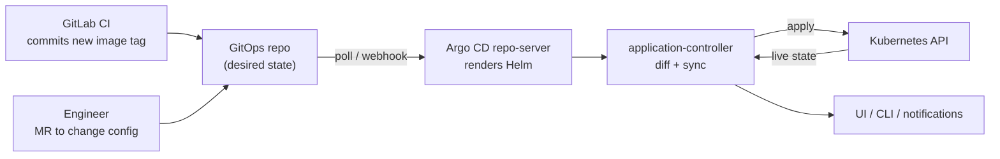
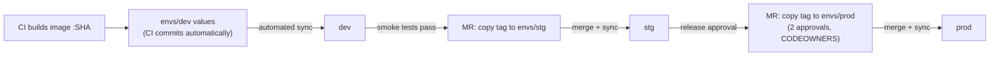
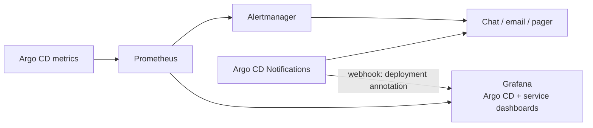

# 7. Argo CD and GitOps

## 7.1 Concepts

| Term | Meaning |
|---|---|
| **Application** | A Kubernetes custom resource: a source (Git path or Helm chart) plus a destination (cluster and namespace) |
| **Target state** | Desired state as files in Git |
| **Live state** | What is currently running in the cluster |
| **Sync status** | Whether live state equals target state |
| **Sync** | Applying changes so the cluster reaches the target state |
| **Refresh** | Comparing the latest Git with live state to find drift |
| **Health** | Whether the application is running correctly and can serve requests |
| **AppProject** | Boundary limiting which repos, clusters and namespaces a team's Applications may use |

**GitOps** means the desired state of the system is declared in Git and an in-cluster agent continuously reconciles reality to it. The practical gains: the cluster credential never leaves the cluster, every production change has an author and a review, rollback is `git revert`, and drift (someone editing the cluster by hand) is visible and optionally self-healed.



## 7.2 Installation (on-prem)

```bash
kubectl create namespace argocd
kubectl apply -n argocd --server-side -f https://raw.githubusercontent.com/argoproj/argo-cd/stable/manifests/ha/install.yaml
```

Prefer pinning a **released version** rather than `stable`, and in production use the HA manifests (or the community Helm chart). Then:

1. Expose the UI through your gateway with TLS (`argocd.acme.internal`).
2. Configure **SSO** (OIDC with your identity provider, or GitLab as an OIDC provider), then **disable the built-in admin user**.
3. Register the GitOps repository with a read-only deploy key or token.
4. Register additional clusters (`argocd cluster add`) from a controlled machine, or run one Argo CD per cluster (simplest isolation).
5. Put Argo CD's own configuration under Argo CD (self-management) once stable.

## 7.3 Repository layout

```text
gitops/
  bootstrap/                      # the root "app of apps" / ApplicationSets
    root-dev.yaml
    root-prod.yaml
  platform/                       # cluster add-ons (cert-manager, metallb, operators, monitoring...)
    cert-manager/
    monitoring/
    ...
  charts/dotnet-service/          # shared chart
  envs/
    dev/<service>/values.yaml
    stg/<service>/values.yaml
    prod/<service>/values.yaml
```

Keep the GitOps repo **separate from application repos** so deploy permissions and review rules differ from code permissions.

## 7.4 Applications

```yaml
apiVersion: argoproj.io/v1alpha1
kind: Application
metadata:
  name: orders-api-dev
  namespace: argocd
  finalizers: [ resources-finalizer.argocd.argoproj.io ]     # delete managed resources with the app
spec:
  project: orders
  source:
    repoURL: https://gitlab.acme.internal/acme/platform/gitops.git
    targetRevision: main
    path: charts/dotnet-service
    helm:
      valueFiles: [ ../../envs/dev/orders-api/values.yaml ]
  destination:
    server: https://kubernetes.default.svc
    namespace: orders-dev
  syncPolicy:
    automated: { prune: true, selfHeal: true }
    syncOptions: [ CreateNamespace=true ]
```

- `prune` deletes resources removed from Git; `selfHeal` reverts manual cluster edits. Enable both in non-prod first.
- Use `ignoreDifferences` for fields that controllers mutate (for example `spec.replicas` when an HPA owns it).

## 7.5 Many services: app-of-apps and ApplicationSets

Argo CD's cluster-bootstrapping documentation describes two approaches:

- **App of apps**: one parent Application whose repository contains only child Application manifests. The documentation calls it an **admin-only tool**: anyone who can create Applications in arbitrary projects is effectively an administrator, so only admins should push to the parent's repository.
- **ApplicationSets** (recommended in the same documentation, particularly the cluster generator): templates that generate Applications from generators (Git directories, cluster list/labels, lists, matrices).

```yaml
apiVersion: argoproj.io/v1alpha1
kind: ApplicationSet
metadata: { name: services-dev, namespace: argocd }
spec:
  generators:
  - git:
      repoURL: https://gitlab.acme.internal/acme/platform/gitops.git
      revision: main
      directories: [ { path: "envs/dev/*" } ]
  template:
    metadata: { name: "{{path.basename}}-dev" }
    spec:
      project: services
      source:
        repoURL: https://gitlab.acme.internal/acme/platform/gitops.git
        targetRevision: main
        path: charts/dotnet-service
        helm: { valueFiles: [ "../../{{path}}/values.yaml" ] }
      destination: { server: https://kubernetes.default.svc, namespace: "{{path.basename}}-dev" }
      syncPolicy: { automated: { prune: true, selfHeal: true } }
```

Adding a service then means adding a directory with a `values.yaml`.

## 7.6 Promotion between environments



- **Dev:** CI writes the new tag; Argo CD syncs automatically.
- **Stg/Prod:** a merge request in the GitOps repo copies the tag. That MR **is** the deploy approval and audit trail. For prod, either auto-sync after merge or require a manual sync for sensitive services.
- Rollback: revert the commit (or sync to a previous revision) and let Argo CD apply.
- Alternatives to "CI commits the tag": Argo CD Image Updater, or Kargo for promotion pipelines. Start with CI commits; they are the easiest to reason about.

## 7.7 Sync waves and hooks

Order resources within a sync using annotations:

```yaml
metadata:
  annotations:
    argocd.argoproj.io/sync-wave: "-1"      # lower waves first
```

Hook phases: `PreSync` (database migration Job), `Sync`, `PostSync` (smoke test), `SyncFail`. Use `hook-delete-policy` to clean up Jobs.

Typical wave order for platform add-ons: namespaces and CRDs (wave -2) -> operators (-1) -> operator custom resources (0) -> applications (1).

## 7.8 Progressive delivery (optional)

**Argo Rollouts** adds `Rollout` resources with canary and blue/green strategies and analysis against Prometheus metrics, with automatic abort on SLO breach. Adopt after the basics are stable; with Istio, traffic shifting can use the mesh.

## 7.9 Monitoring deployments and Argo CD itself

Argo CD exposes Prometheus metrics (application controller, server, repo-server). With the Prometheus Operator, scrape them and alert on:

| Signal | Why |
|---|---|
| Application `sync_status != Synced` for > N minutes | Drift or a failed sync |
| Application `health_status` Degraded/Missing | A broken release |
| Sync failures and operation duration | Repo/render problems |
| repo-server latency and queue depth | Scaling needs |
| Git fetch errors | Credentials or network |

Notifications: Argo CD Notifications can post sync status and health changes to chat or email via templates and triggers. Add the Argo CD UI link and the Grafana dashboard for the service to each message.

Annotate Grafana dashboards with deployments: emit an annotation (from the CI job or from an Argo CD notification webhook) so release times are visible on latency and error graphs.



## 7.10 RBAC and safety

- Use **AppProjects** to restrict source repos, destination clusters/namespaces, and allowed resource kinds per team. Without them any Application can deploy anywhere.
- Map IdP groups to Argo CD roles (read-only for developers; sync rights for the platform team and release managers).
- Secrets are never stored in Git in plain text; Argo CD manages **references** (ExternalSecret objects, chapter 9).
- Protect the GitOps repo like production: approvals, CODEOWNERS, no force-push.

## 7.11 Troubleshooting

| Symptom | Likely cause | First look |
|---|---|---|
| `OutOfSync` forever | A controller mutates a field Git declares (HPA replicas, injected sidecar fields) | App diff; add `ignoreDifferences` |
| `Unknown` / comparison error | Manifest render failure | repo-server logs, `argocd app manifests` |
| Hook Job fails sync | Migration error | Job pod logs; hook delete policy |
| CRD resources fail "no matches for kind" | Sync-wave order; CRD not installed yet | Put operators/CRDs in an earlier wave; use `SkipDryRunOnMissingResource` |
| Everything stale | Webhook not configured and polling interval long | Add GitLab webhook or reduce `timeout.reconciliation` |

## Done when

- [ ] Argo CD runs HA with SSO; admin user disabled.
- [ ] One service is deployed to dev purely by a Git commit and rolled back by a revert.
- [ ] Prod promotion is an approved merge request.
- [ ] Alerts for out-of-sync/degraded apps reach a human; dashboards show deployments.
