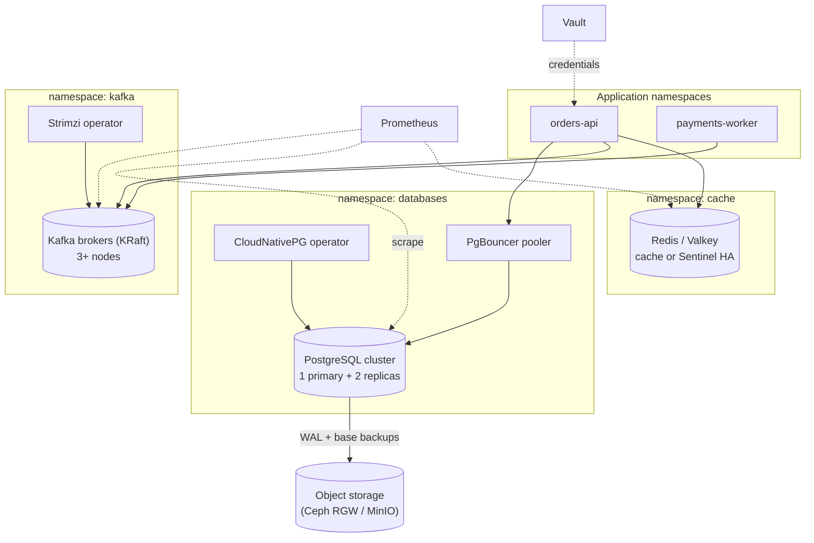

# 8. Data services on Kubernetes: PostgreSQL, Kafka, Redis

Running stateful systems on Kubernetes is practical today **if** you use mature operators, have dependable storage, and monitor and back them up from day one. This chapter gives a working path for each and is honest about trade-offs.



## 8.1 Should this run on Kubernetes at all?

| Factor | Favours Kubernetes (operator) | Favours dedicated VMs / bare metal |
|---|---|---|
| Team skill | Team already operates Kubernetes well | Team is stronger with traditional database operations |
| Storage | Reliable block storage or local NVMe with an operator that replicates | Shared, slow, or unreliable storage |
| Scale | Small to medium | Very large or latency-critical (large Kafka, multi-TB OLTP) |
| Environments | Many ephemeral dev/test copies wanted | Single big production instance |
| Recovery | Operator handles failover and backup | You have existing DBA runbooks and tooling |

A common startup split: **operators for dev/stg and for most production**, with the option to move a single heavy workload to dedicated nodes (node pools with taints) when needed. Dedicated nodes inside the cluster give most of the isolation benefit.

Dedicated node pool pattern:

```bash
kubectl label node data-1 workload=data
kubectl taint node data-1 dedicated=data:NoSchedule
```

```yaml
# in the stateful workload's pod template
nodeSelector: { workload: data }
tolerations: [ { key: dedicated, operator: Equal, value: data, effect: NoSchedule } ]
```

## 8.2 PostgreSQL with CloudNativePG

[CloudNativePG](https://cloudnative-pg.io) is a CNCF-hosted operator that manages PostgreSQL high availability (primary plus streaming replicas), failover, rolling updates, backups with point-in-time recovery to object storage, connection pooling and monitoring. (Zalando's operator and Crunchy PGO are established alternatives.)

```yaml
apiVersion: postgresql.cnpg.io/v1
kind: Cluster
metadata: { name: orders-pg, namespace: databases }
spec:
  instances: 3
  imageName: ghcr.io/cloudnative-pg/postgresql:17      # mirror this into your own registry
  storage: { size: 100Gi, storageClass: fast-rwo }
  walStorage: { size: 20Gi, storageClass: fast-rwo }
  postgresql:
    parameters: { max_connections: "200", shared_buffers: "1GB" }
  resources:
    requests: { cpu: "2", memory: 4Gi }
    limits:   { memory: 4Gi }
  affinity: { enablePodAntiAffinity: true, topologyKey: kubernetes.io/hostname }
  monitoring: { enablePodMonitor: true }
  backup:
    retentionPolicy: "14d"
    # object-store settings (Barman Cloud) go here or in the plugin configuration;
    # the recommended mechanism has changed between releases - follow the docs for your version
---
apiVersion: postgresql.cnpg.io/v1
kind: Pooler
metadata: { name: orders-pg-rw, namespace: databases }
spec:
  cluster: { name: orders-pg }
  instances: 2
  type: rw
  pgbouncer: { poolMode: transaction, parameters: { max_client_conn: "1000", default_pool_size: "20" } }
```

Operational notes:

- **Backups and PITR are not optional.** Continuous WAL archiving to object storage plus scheduled base backups lets you restore to a point in time. **Test a restore into a scratch cluster** on a schedule.
- Applications connect through the **Pooler Service** (PgBouncer); .NET connection pools plus many replicas can exhaust `max_connections` quickly.
- The operator creates Services for read-write (`-rw`), read-only (`-ro`) and any (`-r`). Point write traffic at `-rw`.
- Credentials: let Vault's **database secrets engine** issue short-lived users (chapter 9), or generate with the operator and sync to Vault.
- Major-version upgrades need planning (in-place import or logical replication); practise in non-prod.
- Run EF Core migrations as a pre-sync Job (chapter 6) using a migration-capable role, and give the app a least-privilege role.

## 8.3 Kafka with Strimzi (KRaft)

[Strimzi](https://strimzi.io) is a CNCF operator that runs Apache Kafka on Kubernetes, managing brokers, users, topics, rolling updates, TLS and metrics. Modern Kafka runs in **KRaft** mode (Kafka's own consensus, no ZooKeeper); in Strimzi, brokers and controllers are defined with `KafkaNodePool` resources.

```yaml
apiVersion: kafka.strimzi.io/v1beta2          # check the API version your Strimzi release serves
kind: KafkaNodePool
metadata:
  name: combined
  namespace: kafka
  labels: { strimzi.io/cluster: main }
spec:
  replicas: 3
  roles: [ controller, broker ]
  storage:
    type: jbod
    volumes: [ { id: 0, type: persistent-claim, size: 500Gi, class: fast-rwo, deleteClaim: false } ]
  resources: { requests: { cpu: "2", memory: 8Gi }, limits: { memory: 8Gi } }
---
apiVersion: kafka.strimzi.io/v1beta2
kind: Kafka
metadata:
  name: main
  namespace: kafka
  annotations:
    strimzi.io/node-pools: enabled
    strimzi.io/kraft: enabled
spec:
  kafka:
    version: "<kafka-version-supported-by-your-strimzi>"
    listeners:
    - { name: internal, port: 9093, type: internal, tls: true, authentication: { type: scram-sha-512 } }
    config:
      default.replication.factor: 3
      min.insync.replicas: 2
      offsets.topic.replication.factor: 3
      transaction.state.log.replication.factor: 3
      transaction.state.log.min.isr: 2
    metricsConfig:
      type: jmxPrometheusExporter
      valueFrom: { configMapKeyRef: { name: kafka-metrics, key: kafka-metrics-config.yml } }
  entityOperator: { topicOperator: {}, userOperator: {} }
---
apiVersion: kafka.strimzi.io/v1beta2
kind: KafkaTopic
metadata:
  name: orders.created
  namespace: kafka
  labels: { strimzi.io/cluster: main }
spec:
  partitions: 12
  replicas: 3
  config: { retention.ms: "604800000", min.insync.replicas: "2" }
---
apiVersion: kafka.strimzi.io/v1beta2
kind: KafkaUser
metadata:
  name: orders-api
  namespace: kafka
  labels: { strimzi.io/cluster: main }
spec:
  authentication: { type: scram-sha-512 }
  authorization:
    type: simple
    acls:
    - { resource: { type: topic, name: orders., patternType: prefix }, operations: [ Read, Write, Describe ] }
    - { resource: { type: group, name: orders-, patternType: prefix }, operations: [ Read ] }
```

Notes:

- **Separate controller and broker roles** (`roles: [controller]` and `[broker]` in separate pools) for production; combined roles are fine for small clusters.
- `replication.factor 3` with `min.insync.replicas 2` tolerates one broker loss without data loss for `acks=all` producers.
- Spread brokers across nodes/zones (pod anti-affinity or topology spread; Strimzi supports rack awareness).
- Local NVMe volumes suit Kafka well because partitions are already replicated.
- Strimzi writes a Secret per `KafkaUser`; sync it to the application namespace via Vault or External Secrets rather than letting applications read across namespaces.
- Add **Cruise Control** for rebalancing and a Kafka UI for operators; export **consumer lag** (Kafka Exporter) and alert on it per group: lag is the most useful application-level signal.
- Plan upgrades: Strimzi operator first, then Kafka version, one step at a time, in non-prod first.
- Set topic **partition count** with future parallelism in mind; increasing partitions later changes key-to-partition mapping.

.NET client settings worth setting explicitly: `EnableIdempotence=true`, `Acks=All`, sensible `LingerMs`/batching, and consumer `EnableAutoCommit=false` with manual commit after processing (or a library such as KafkaFlow/MassTransit that manages it).

## 8.4 Redis (or Valkey)

Decide first **what Redis is for**:

| Use | Persistence | HA | Pattern |
|---|---|---|---|
| Pure cache (can be rebuilt) | None | Optional | One replica, or a small set behind client-side fallback |
| Session / rate-limit counters | Optional | Yes | Primary + replicas with Sentinel |
| Durable queues / data | AOF + snapshots | Yes | Treat like a database; prefer a purpose-built system if loss is unacceptable |
| Very large keyspace | Optional | Yes | Redis Cluster (sharded) |

Licensing and packaging have moved in recent years: Redis changed its licence terms, a community fork (**Valkey**) exists under the Linux Foundation, and **Bitnami's free container images and charts were restructured in 2025** (most versioned images moved to a legacy repository with no further updates; the maintained path became a paid offering). Practical consequences: **do not depend on Bitnami charts/images for a new build**; mirror whichever image you adopt into your own registry, and check the current licence of the Redis or Valkey version you choose.

### Minimal cache-only deployment

```yaml
apiVersion: apps/v1
kind: Deployment
metadata: { name: redis, namespace: cache }
spec:
  replicas: 1
  selector: { matchLabels: { app: redis } }
  template:
    metadata: { labels: { app: redis } }
    spec:
      containers:
      - name: redis
        image: registry.acme.internal/docker-base/valkey:8      # mirrored image of your choice
        args: [ "--save", "", "--appendonly", "no", "--maxmemory", "768mb", "--maxmemory-policy", "allkeys-lru" ]
        ports: [ { containerPort: 6379 } ]
        resources: { requests: { cpu: 100m, memory: 1Gi }, limits: { memory: 1Gi } }
        securityContext: { runAsNonRoot: true, allowPrivilegeEscalation: false }
---
apiVersion: v1
kind: Service
metadata: { name: redis, namespace: cache }
spec: { selector: { app: redis }, ports: [ { port: 6379 } ] }
```

Require a password (`--requirepass` from a Secret) and a NetworkPolicy limiting clients, even for a cache.

### HA with Sentinel (or Cluster) via an operator

For anything beyond a throwaway cache use an **operator** that manages replication, Sentinel/Cluster topology, failover and rolling updates (several community operators exist for Redis and for Valkey; evaluate maintenance activity and licence). Deploy 3 Sentinels and 1 primary + 2 replicas, spread across nodes, with a PVC if you need persistence, and a `PodDisruptionBudget`.

### .NET usage

- One `ConnectionMultiplexer` (StackExchange.Redis) per process, registered as a singleton.
- Use `IDistributedCache` for ASP.NET Core caching abstractions, with sensible expirations.
- Handle cache failure as a degradation, not an outage (timeouts, fallback to the source of truth).

## 8.5 Monitoring the data tier

| Service | Metrics source | Alert on |
|---|---|---|
| PostgreSQL | Operator PodMonitor / postgres exporter | Replication lag, connections near max, WAL archive failures, disk > 80%, failed backups |
| Kafka | JMX exporter + Kafka Exporter | Under-replicated partitions, offline partitions, consumer lag, disk usage, controller count |
| Redis | redis exporter | Memory near maxmemory, evictions (for non-cache use), replication break, high latency |

Dashboards: import the community dashboards for each exporter into Grafana, then adapt (chapter 11).

## 8.6 Backup and disaster recovery summary

| Service | Backup | Restore test |
|---|---|---|
| PostgreSQL | Base backups + continuous WAL to object storage; PITR | Monthly restore to a scratch cluster, verify row counts |
| Kafka | Replicate with MirrorMaker 2 to a second cluster for DR; topics are not "backed up" like databases | Fail a consumer group over to the mirror in non-prod |
| Redis | Only if durable: RDB/AOF to a PVC and snapshots | Restore into a scratch instance |
| PVC-level | CSI volume snapshots + Velero for the namespace objects | Restore a namespace into a test cluster |

## Done when

- [ ] PostgreSQL cluster survives a primary pod delete with automatic failover; a PITR restore has worked.
- [ ] Kafka cluster tolerates one broker restart; a test producer/consumer using SCRAM credentials works; lag alert fires on a stalled consumer.
- [ ] Redis is deployed in the mode that matches its use, with auth and a NetworkPolicy.
- [ ] Every service is scraped and has at least one alert.
