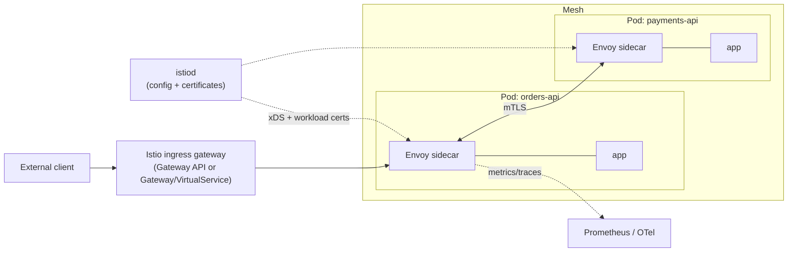

# 10. Istio service mesh

## 10.1 Should you adopt a mesh now?

A service mesh moves service-to-service concerns (encryption, identity, authorisation, retries, telemetry) out of application code and into the platform.

| Adopt when | Wait when |
|---|---|
| Compliance requires encryption in transit between services | Fewer than ~5-10 services |
| You want identity-based authorisation between namespaces/teams | Team is still learning Kubernetes basics |
| You need canary/traffic splitting, or consistent retries/timeouts | Debugging capacity is limited |
| Many teams share the cluster | You can get TLS from the application stack directly |

A mesh adds sidecars (or node proxies), an upgrade stream, and new failure modes. Add it after observability exists (chapter 11) so you can see what it does.

## 10.2 Architecture



- **istiod** is the control plane: distributes configuration and issues short-lived workload certificates (identity is the Kubernetes service account).
- **Data plane**: an Envoy sidecar per pod (default) or, in **ambient mode**, node-level proxies without per-pod sidecars. Ambient mode is available in recent Istio releases; evaluate its maturity for your chosen version before choosing it for production.

## 10.3 Installation

```bash
istioctl install --set profile=default -y      # or use the Helm charts via Argo CD
kubectl label namespace orders-prod istio-injection=enabled
kubectl -n orders-prod rollout restart deployment      # pods must restart to receive the sidecar
```

Manage Istio through Argo CD (base, istiod, gateway charts) with **revision-based canary upgrades**: install the new control-plane revision beside the old one, move namespaces one at a time by changing the injection label, then remove the old revision.

## 10.4 mTLS and authorisation

**PeerAuthentication** sets the mTLS mode: `PERMISSIVE` (accept both), `STRICT` (mTLS only), `DISABLE`. Scope is most-specific-wins: workload, then namespace, then mesh. Roll out as **PERMISSIVE** first (to find clients outside the mesh), then **STRICT**.

**AuthorizationPolicy** has a selector, an action (`ALLOW`, `DENY`, `CUSTOM`, `AUDIT`) and rules (`from`, `to`, `when`). Evaluation order: CUSTOM, then DENY, then ALLOW. A workload with **no** policy accepts all requests; once it has at least one `ALLOW` policy, anything not matching an `ALLOW` rule is denied.

**RequestAuthentication** validates end-user JWTs (issuer, JWKS). A request with **no** token is accepted unless an authorisation rule requires a request principal.

```yaml
apiVersion: security.istio.io/v1
kind: PeerAuthentication
metadata: { name: default, namespace: istio-system }      # mesh-wide
spec: { mtls: { mode: STRICT } }
---
apiVersion: security.istio.io/v1
kind: AuthorizationPolicy
metadata: { name: orders-api-allow, namespace: orders-prod }
spec:
  selector: { matchLabels: { app.kubernetes.io/name: orders-api } }
  action: ALLOW
  rules:
  - from:
    - source: { namespaces: [ istio-system ] }                                       # gateway
    - source: { principals: [ "cluster.local/ns/checkout-prod/sa/checkout-api" ] }   # one specific caller
---
apiVersion: security.istio.io/v1
kind: RequestAuthentication
metadata: { name: jwt, namespace: orders-prod }
spec:
  selector: { matchLabels: { app.kubernetes.io/name: orders-api } }
  jwtRules: [ { issuer: "https://idp.acme.internal", jwksUri: "https://idp.acme.internal/.well-known/jwks.json" } ]
```

Namespace-level `from` is coarse; for sensitive services list service-account **principals**. Treat these policies as part of each service's Helm values so they are reviewed with the code.

## 10.5 Traffic management

```yaml
apiVersion: networking.istio.io/v1
kind: DestinationRule
metadata: { name: orders-api, namespace: orders-prod }
spec:
  host: orders-api
  subsets:
  - { name: stable, labels: { version: v1 } }
  - { name: canary, labels: { version: v2 } }
  trafficPolicy:
    connectionPool: { http: { http1MaxPendingRequests: 100, maxRequestsPerConnection: 10 } }
    outlierDetection: { consecutive5xxErrors: 5, interval: 10s, baseEjectionTime: 30s }
---
apiVersion: networking.istio.io/v1
kind: VirtualService
metadata: { name: orders-api, namespace: orders-prod }
spec:
  hosts: [ orders-api ]
  http:
  - route:
    - { destination: { host: orders-api, subset: stable }, weight: 90 }
    - { destination: { host: orders-api, subset: canary }, weight: 10 }
    timeout: 10s
    retries: { attempts: 2, perTryTimeout: 3s, retryOn: "5xx,connect-failure" }
```

Retries multiply load during an outage and can duplicate non-idempotent requests. Limit them to idempotent calls and cap attempts.

## 10.6 Operational gotchas

| Issue | Detail | Mitigation |
|---|---|---|
| **Jobs never complete** | The sidecar keeps the pod alive after the main container exits | Use Kubernetes **native sidecar containers** where your Istio and Kubernetes versions support them, or an entrypoint wrapper that stops the proxy on exit |
| **App starts before the proxy** | First outbound calls fail | Enable Istio's option to hold the application until the proxy is ready |
| **Non-HTTP protocols** | Kafka, PostgreSQL and Redis are TCP | Name Service ports with a `tcp-` prefix (or set `appProtocol`); decide whether data namespaces are in or out of the mesh; with strict mTLS, in-mesh data services need sidecars too, or exempt them with a PeerAuthentication `PERMISSIVE`/port exception |
| **Upgrades** | Sidecar version must roll with pods | Revision-based canary upgrades; schedule restarts |
| **Resource cost** | Each sidecar needs CPU and memory | Set sidecar requests via annotations; consider ambient mode |
| **Debugging** | An extra hop and extra logs | `istioctl proxy-status`, `istioctl analyze`, access logs, Kiali |

## 10.7 Edge: Istio gateway with the Gateway API

Istio implements the Kubernetes Gateway API, so the same `Gateway` and `HTTPRoute` resources from chapter 2 can be served by Istio. Using the Istio gateway as your single edge avoids running a separate ingress controller. The retired community ingress-nginx project (chapter 2) is not a recommended starting point.

## 10.8 Observability from the mesh

Istio sidecars emit standard request metrics (rate, errors, duration), access logs and trace spans for every call between meshed services without code changes. Scrape the proxies with Prometheus, send spans to your OTel Collector (chapter 11), and use Kiali for a live dependency graph if desired. Application-level OTel instrumentation and mesh telemetry complement each other: the mesh sees traffic between pods, the application sees inside a request.

## Done when

- [ ] Mesh installed via Argo CD; one namespace meshed with injection.
- [ ] Mesh-wide STRICT mTLS after a PERMISSIVE trial.
- [ ] Each service has an ALLOW policy listing real callers; an unlisted caller gets `403`.
- [ ] Jobs and migrations complete cleanly despite the sidecar.
- [ ] A control-plane revision upgrade has been rehearsed.
