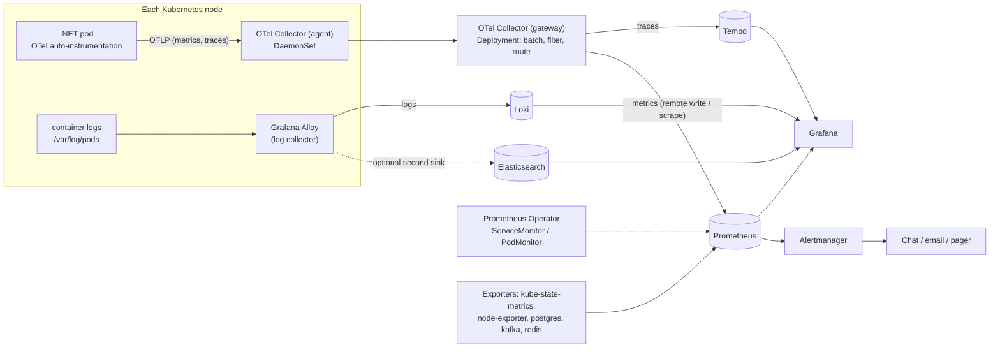

# 11. Observability: OpenTelemetry, Prometheus, Loki, Elasticsearch, Tempo, Grafana

## 11.1 The three signals

| Signal | Answers | Stored in |
|---|---|---|
| **Metrics** | Is it healthy? How much? How fast? (cheap, aggregated) | Prometheus |
| **Logs** | What exactly happened in this request or at this time? | Loki and/or Elasticsearch |
| **Traces** | Where did the time go across services? | Tempo |

Correlation ties them together: every log line and metric exemplar carries the **trace ID**, so you can jump from a latency spike to the slow trace to the exact logs.

## 11.2 Reference architecture



Components and responsibilities:

| Component | Job |
|---|---|
| **OpenTelemetry Operator** | Manages Collectors and injects language auto-instrumentation into pods |
| **OTel Collector (agent + gateway)** | Receives OTLP, processes (batch, filter, add Kubernetes metadata), exports to backends |
| **kube-prometheus-stack** | Prometheus Operator, Prometheus, Alertmanager, Grafana, node-exporter, kube-state-metrics, default rules |
| **Grafana Alloy** | Collects container logs (and can do more); successor to Promtail |
| **Loki** | Label-indexed log store on object storage; cheap, great for "show me logs for this pod/trace" |
| **Elasticsearch (ECK operator)** | Full-text indexed search and analytics over logs/events; heavier |
| **Tempo** | Trace store on object storage |
| **Grafana** | One UI over all signals, dashboards and alerts |

## 11.3 OpenTelemetry for .NET

### Option 1: Zero-code auto-instrumentation via the OpenTelemetry Operator

The operator's `Instrumentation` resource describes how to instrument pods; a pod annotation enables it. The official operator documentation describes the .NET annotation `instrumentation.opentelemetry.io/inject-dotnet: "true"` (the value can also name a specific `Instrumentation` resource). The `Instrumentation` examples in the docs use `apiVersion: opentelemetry.io/v1alpha1`, so check the version your operator serves.

```yaml
apiVersion: opentelemetry.io/v1alpha1
kind: Instrumentation
metadata: { name: dotnet, namespace: monitoring }
spec:
  exporter:
    endpoint: http://otel-agent-collector.monitoring:4318      # OTLP over HTTP
  propagators: [ tracecontext, baggage ]
  sampler: { type: parentbased_traceidratio, argument: "0.1" }  # sample 10% of new traces
  dotnet:
    env:
    - { name: OTEL_DOTNET_AUTO_LOGS_ENABLED, value: "false" }   # logs go via stdout -> Alloy
```

```yaml
# on the Deployment's pod template
metadata:
  annotations:
    instrumentation.opentelemetry.io/inject-dotnet: "monitoring/dotnet"
    instrumentation.opentelemetry.io/container-names: "orders-api"
```

The operator injects an init container with the .NET auto-instrumentation and sets the environment so the runtime loads it. By default it exports OTLP with the `http/protobuf` protocol. The agent bundles many instrumentations; disable noisy ones with `OTEL_DOTNET_AUTO_<SIGNAL>_<NAME>_INSTRUMENTATION_ENABLED=false`.

### Option 2: SDK in code (more control)

```csharp
// dotnet add package OpenTelemetry.Extensions.Hosting
// dotnet add package OpenTelemetry.Instrumentation.AspNetCore
// dotnet add package OpenTelemetry.Instrumentation.Http
// dotnet add package OpenTelemetry.Instrumentation.Runtime
// dotnet add package OpenTelemetry.Exporter.OpenTelemetryProtocol
builder.Services.AddOpenTelemetry()
    .ConfigureResource(r => r.AddService("orders-api", serviceVersion: Environment.GetEnvironmentVariable("APP_RELEASE")))
    .WithTracing(t => t
        .AddAspNetCoreInstrumentation()
        .AddHttpClientInstrumentation()
        .AddSource("Acme.Orders")                  // your ActivitySource for custom spans
        .AddOtlpExporter())
    .WithMetrics(m => m
        .AddAspNetCoreInstrumentation()
        .AddRuntimeInstrumentation()
        .AddMeter("Acme.Orders")                   // your custom metrics
        .AddOtlpExporter());
```

Endpoint and protocol come from standard variables set by the Helm chart (`OTEL_EXPORTER_OTLP_ENDPOINT`, `OTEL_EXPORTER_OTLP_PROTOCOL`, `OTEL_SERVICE_NAME`, `OTEL_RESOURCE_ATTRIBUTES=deployment.environment=prod,service.namespace=orders`).

Custom business metrics with `System.Diagnostics.Metrics`:

```csharp
static readonly Meter Meter = new("Acme.Orders");
static readonly Counter<long> OrdersCreated = Meter.CreateCounter<long>("orders.created");
// OrdersCreated.Add(1, new KeyValuePair<string, object?>("channel", "web"));
```

Keep metric **label cardinality low**: never use user IDs, order IDs or raw URLs as labels.

### Logging that correlates

Write JSON to stdout including trace and span IDs (Serilog with a JSON formatter and the `Enrich.WithSpan()`-style enrichers, or the .NET JSON console logger with scopes). Then a log line contains `TraceId`, and Grafana can link log to trace.

```csharp
builder.Host.UseSerilog((ctx, lc) => lc
    .ReadFrom.Configuration(ctx.Configuration)
    .Enrich.FromLogContext()
    .Enrich.WithProperty("service", "orders-api")
    .WriteTo.Console(new Serilog.Formatting.Compact.RenderedCompactJsonFormatter()));
```

## 11.4 Metrics: Prometheus, scraping and the Collector

Two ways metrics reach Prometheus:

1. **Pull (scrape).** Services (or the Collector's Prometheus exporter) expose `/metrics`; a `ServiceMonitor`/`PodMonitor` tells the Prometheus Operator what to scrape. Best for infrastructure exporters (node, kube-state, databases, Kafka, Redis).
2. **Push (OTLP).** The application exports OTLP to the Collector, which forwards to Prometheus by remote write (Prometheus must have its receiver enabled) or exposes a scrape endpoint. Best for application metrics from OTel SDKs.

```yaml
# kube-prometheus-stack values (shape only)
prometheus:
  prometheusSpec:
    retention: 15d
    enableRemoteWriteReceiver: true
    serviceMonitorSelectorNilUsesHelmValues: false     # pick up ServiceMonitors from all namespaces
    storageSpec:
      volumeClaimTemplate:
        spec: { storageClassName: fast-rwo, resources: { requests: { storage: 200Gi } } }
grafana:
  sidecar:
    dashboards: { enabled: true, label: grafana_dashboard, searchNamespace: ALL }
    datasources: { enabled: true }
```

```yaml
apiVersion: monitoring.coreos.com/v1
kind: PodMonitor
metadata: { name: orders-api, namespace: orders-prod }
spec:
  selector: { matchLabels: { app.kubernetes.io/name: orders-api } }
  podMetricsEndpoints: [ { port: metrics, path: /metrics } ]
```

For long-term retention and very large series counts, put Mimir or VictoriaMetrics behind Prometheus; 15 days local is a fine start.

## 11.5 Collector configuration (agent and gateway)

```yaml
apiVersion: opentelemetry.io/v1beta1
kind: OpenTelemetryCollector
metadata: { name: otel-gateway, namespace: monitoring }
spec:
  mode: deployment
  replicas: 2
  config:
    receivers:
      otlp: { protocols: { grpc: {}, http: {} } }
    processors:
      memory_limiter: { check_interval: 1s, limit_percentage: 80, spike_limit_percentage: 20 }
      k8sattributes: {}                      # adds pod, namespace, node metadata
      batch: {}
    exporters:
      otlp/tempo: { endpoint: tempo.monitoring:4317, tls: { insecure: true } }
      prometheusremotewrite: { endpoint: http://prometheus-operated.monitoring:9090/api/v1/write }
    service:
      pipelines:
        traces:  { receivers: [otlp], processors: [memory_limiter, k8sattributes, batch], exporters: [otlp/tempo] }
        metrics: { receivers: [otlp], processors: [memory_limiter, k8sattributes, batch], exporters: [prometheusremotewrite] }
```

Run an **agent** Collector as a DaemonSet (close to pods, cheap) forwarding to the **gateway** Deployment (central processing, sampling, routing). Use `insecure` TLS only inside a trusted network; prefer mTLS between collectors.

Sampling: head sampling at the SDK (`parentbased_traceidratio`) is simple; tail sampling in the gateway (keep errors and slow traces, sample the rest) gives better data at higher cost.

## 11.6 Logs: Loki, Elasticsearch, or both

| | **Loki** | **Elasticsearch** |
|---|---|---|
| Indexing | Labels only (cheap); log text is grepped at query time | Full-text inverted index |
| Cost and footprint | Low; object storage | Higher CPU, RAM, disk |
| Best for | "Logs for this pod / service / trace", troubleshooting, dashboards from logs | Free-text search at scale, analytics, audit/compliance, SIEM-style use |
| Query language | LogQL | KQL / Lucene / ES|QL |
| Operations | Simpler | More tuning (shards, ILM, heap) |

**Recommendation:** default to **Loki**. Add **Elasticsearch** only for data that needs rich search or long-retention audit (for example security audit logs, Vault audit, application audit events). Avoid shipping every log to both: you pay twice.

Important: **Promtail reached end of life on 2 March 2026**; all new collection work happens in **Grafana Alloy**, which includes a conversion command for existing Promtail configs (Grafana Alloy migration documentation). Use Alloy for new installs.

### Loki

Loki can run as a single binary (small), or distributed for scale; store chunks and index in object storage (Ceph RGW or MinIO). Check the Loki documentation for the deployment modes currently supported and recommended for your version.

```yaml
# Loki (Helm chart values, single binary, illustrative)
deploymentMode: SingleBinary
loki:
  auth_enabled: false
  commonConfig: { replication_factor: 1 }
  storage:
    type: s3
    s3: { endpoint: http://rgw.storage:80, bucketnames: loki, access_key_id: "${LOKI_S3_ACCESS}", secret_access_key: "${LOKI_S3_SECRET}", s3ForcePathStyle: true, insecure: true }
  limits_config: { retention_period: 744h }
singleBinary: { replicas: 1 }
```

(Inject the S3 keys from a Kubernetes Secret created by External Secrets, not literals.)

### Alloy: collect container logs and ship to Loki

```alloy
// config.alloy (illustrative)
discovery.kubernetes "pods" { role = "pod" }

discovery.relabel "pods" {
  targets = discovery.kubernetes.pods.targets
  rule { source_labels = ["__meta_kubernetes_namespace"]           target_label = "namespace" }
  rule { source_labels = ["__meta_kubernetes_pod_name"]            target_label = "pod" }
  rule { source_labels = ["__meta_kubernetes_pod_label_app_kubernetes_io_name"] target_label = "app" }
}

loki.source.kubernetes "pods" {
  targets    = discovery.relabel.pods.output
  forward_to = [loki.process.json.receiver]
}

loki.process "json" {
  stage.json { expressions = { level = "@l", trace_id = "TraceId" } }
  stage.labels { values = { level = "" } }          // keep labels few and low-cardinality
  forward_to = [loki.write.default.receiver]
}

loki.write "default" {
  endpoint { url = "http://loki.logging:3100/loki/api/v1/push" }
}
```

Label discipline: labels are the Loki index. Use `namespace`, `app`, `level`, `cluster`; **never** put trace IDs, user IDs or request IDs in labels (keep them in the log line and filter with `|= "trace-id"` or structured metadata).

### Elasticsearch (ECK operator)

[Elastic Cloud on Kubernetes (ECK)](https://www.elastic.co/guide/en/cloud-on-k8s/current/index.html) manages Elasticsearch and Kibana clusters, certificates and upgrades.

```yaml
apiVersion: elasticsearch.k8s.elastic.co/v1
kind: Elasticsearch
metadata: { name: logs, namespace: logging }
spec:
  version: "<elastic-version>"
  nodeSets:
  - name: data
    count: 3
    config: { node.store.allow_mmap: false }      # or set vm.max_map_count on nodes
    volumeClaimTemplates:
    - metadata: { name: elasticsearch-data }
      spec: { accessModes: [ReadWriteOnce], storageClassName: fast-rwo, resources: { requests: { storage: 500Gi } } }
    podTemplate:
      spec:
        containers:
        - name: elasticsearch
          resources: { requests: { cpu: "2", memory: 8Gi }, limits: { memory: 8Gi } }
---
apiVersion: kibana.k8s.elastic.co/v1
kind: Kibana
metadata: { name: logs, namespace: logging }
spec:
  version: "<elastic-version>"
  count: 1
  elasticsearchRef: { name: logs }
```

Ship to Elasticsearch with **Fluent Bit** or **Elastic Agent/Filebeat** from each node, or with the OpenTelemetry Collector (contrib distribution) using the `filelog` receiver and the Elasticsearch exporter. Plan **index lifecycle management (ILM)**: hot -> warm -> delete by age and size, rollover on size, to control disk. Set `number_of_shards` and replicas deliberately; too many small shards is the commonest performance problem.

### Collecting once and routing to both

If you do need both backends, use one collection pipeline with two exporters instead of two agents per node: for example the OTel Collector (contrib) `filelog` receiver -> processors -> `otlphttp` (Loki's OTLP endpoint) and `elasticsearch` exporters; or Alloy for Loki plus Fluent Bit filtered to specific namespaces/streams for Elasticsearch. Route **by stream**: platform and app logs to Loki; audit streams to Elasticsearch.

## 11.7 Traces: Tempo

Tempo stores traces on object storage and is queried from Grafana. Add it as a data source and enable **trace-to-logs** (link by `trace_id`) and **trace-to-metrics** in the Grafana data source settings. Services emit traces via OTel to the gateway Collector.

## 11.8 Grafana: dashboards and alerts as code

Provision data sources and dashboards from Git, delivered by Argo CD:

```yaml
# a dashboard shipped as a ConfigMap; the chart's sidecar loads it
apiVersion: v1
kind: ConfigMap
metadata:
  name: dashboard-orders-api
  namespace: monitoring
  labels: { grafana_dashboard: "1" }
data:
  orders-api.json: |
    { "title": "orders-api", "panels": [ ... ] }
```

Provisioned data sources (illustrative):

```yaml
apiVersion: 1
datasources:
- { name: Prometheus, type: prometheus, url: http://prometheus-operated.monitoring:9090, isDefault: true }
- name: Loki
  type: loki
  url: http://loki.logging:3100
  jsonData:
    derivedFields: [ { name: TraceID, matcherRegex: '"TraceId":"(\w+)"', url: '$${__value.raw}', datasourceUid: tempo } ]
- { name: Tempo, type: tempo, uid: tempo, url: http://tempo.monitoring:3100 }
```

### Dashboards every service needs

Use the **RED** method for services and **USE** for resources.

| Dashboard | Panels |
|---|---|
| Service overview | Request rate, error rate, latency p50/p95/p99 (from `http.server.request.duration`), saturation (CPU/memory vs requests/limits), pod restarts, deployments as annotations |
| .NET runtime | GC pause and collections, heap size, thread pool queue length, exceptions per second |
| Dependencies | Database latency and connection pool use, Kafka consumer lag, Redis hit ratio and latency |
| Logs and traces | Panel of error logs with a link to the trace; trace search by service and duration |
| Platform | Node health, PVC usage, Argo CD application health, certificate expiry |

Example PromQL (metric names depend on your instrumentation and exporter settings; check what your Prometheus actually stores):

```promql
# request rate by route
sum by (http_route) (rate(http_server_request_duration_seconds_count{service_name="orders-api"}[5m]))
# error ratio
sum(rate(http_server_request_duration_seconds_count{service_name="orders-api",http_response_status_code=~"5.."}[5m]))
  / sum(rate(http_server_request_duration_seconds_count{service_name="orders-api"}[5m]))
# p95 latency
histogram_quantile(0.95, sum by (le) (rate(http_server_request_duration_seconds_bucket{service_name="orders-api"}[5m])))
```

### Alerts

Define alerts as `PrometheusRule` objects in Git next to each service's Helm values; route through Alertmanager.

```yaml
apiVersion: monitoring.coreos.com/v1
kind: PrometheusRule
metadata: { name: orders-api, namespace: orders-prod, labels: { release: kube-prometheus-stack } }
spec:
  groups:
  - name: orders-api
    rules:
    - alert: OrdersApiHighErrorRate
      expr: |
        sum(rate(http_server_request_duration_seconds_count{service_name="orders-api",http_response_status_code=~"5.."}[5m]))
        / sum(rate(http_server_request_duration_seconds_count{service_name="orders-api"}[5m])) > 0.05
      for: 10m
      labels: { severity: page, team: orders }
      annotations:
        summary: "orders-api 5xx ratio above 5% for 10m"
        runbook_url: "https://wiki.acme.internal/runbooks/orders-api-errors"
```

Alerting principles: alert on **symptoms users feel** (errors, latency, saturation, backlog), every alert has a runbook and an owner, and page only for what needs a human now. Define SLOs (availability, latency) and alert on error-budget burn rate for important services.

## 11.9 Sizing and retention starting points

| Backend | Starting point | Retention |
|---|---|---|
| Prometheus | 1-2 replicas, 200 Gi SSD | 15 days local; long-term store optional |
| Loki | Single binary, object storage | 14-31 days |
| Elasticsearch | 3 data nodes, 8 GB RAM each | By ILM: e.g. 7 days hot, 30 days total for app logs; longer for audit |
| Tempo | Object storage | 3-7 days (sample aggressively) |

Watch the cost drivers: **metric cardinality**, **log volume** (reduce debug logging in prod, drop health-check access logs), and **trace sampling rate**.

## 11.10 Monitor the monitors

- Alertmanager and Prometheus have a "dead man's switch" alert (always firing) routed to an external check so silence is detected.
- Back up Grafana (dashboards are in Git, so mainly users and annotations), and keep the alert routing config in Git.
- Alert on Collector queue/drop metrics, Loki ingestion errors and Elasticsearch cluster status.

## Done when

- [ ] Each pod's traces, runtime metrics and JSON logs reach Tempo, Prometheus and Loki with matching trace IDs.
- [ ] A Grafana dashboard per service exists in Git and deploys through Argo CD.
- [ ] An alert fires end to end into your notification channel, with a runbook link.
- [ ] If Elasticsearch is used, only the streams that need it flow there, with ILM in place.
