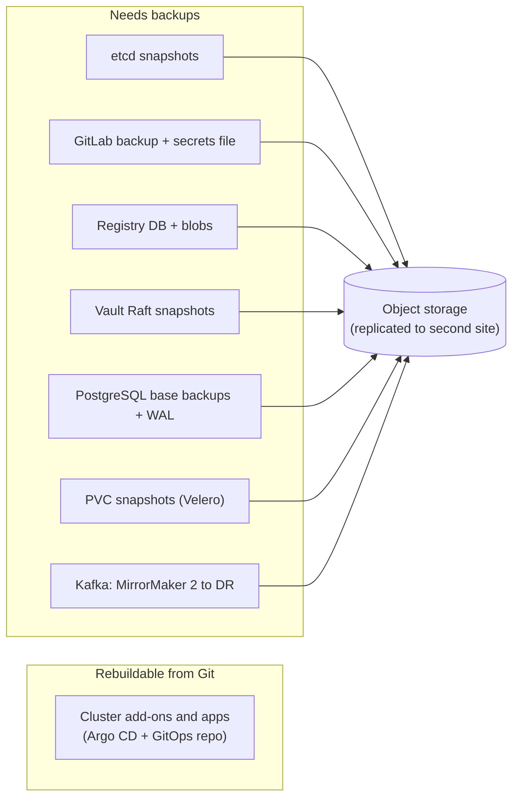

# 12. Operations, security and disaster recovery

## 12.1 Security hardening checklist

| Layer | Controls |
|---|---|
| **Identity** | One IdP with SSO and MFA for GitLab, Argo CD, Grafana, Vault, registry; short sessions; group-based roles |
| **GitLab** | Protected branches, required approvals, CODEOWNERS, push rules, secret detection, SAST, dependency scanning, audit events shipped to logs |
| **Runners** | Ephemeral job pods, rootless builds, separate trust tiers, network egress controls, no shared Docker socket |
| **Supply chain** | Mirrored and scanned base images, locked dependencies, package source mapping, image scanning, SBOMs, optional image signing with admission verification |
| **Registry** | Immutable release tags, scoped robot accounts, retention, replication, backups |
| **Kubernetes** | Pod Security Standards (restricted) per namespace, non-root, read-only root FS, dropped capabilities, default-deny NetworkPolicies, ResourceQuotas, least-privilege RBAC, audit logging, regular node patching |
| **Policy as code** | Kyverno or Gatekeeper: require limits, forbid `:latest` and privileged pods, enforce registry allow-list |
| **Argo CD** | SSO, AppProjects, no admin user, Git-only changes, notifications on failures |
| **Istio** | Mesh-wide STRICT mTLS, ALLOW policies per workload, gateway only for explicit hosts |
| **Vault** | Per-app policies, short TTLs, audit devices on, tested auto-unseal, rotation schedule, access review |
| **Data** | TLS everywhere, per-service credentials, backups encrypted, restore tested |
| **Secrets** | None in Git; leaked ones rotated; secret scanning in CI |

## 12.2 Backup and recovery matrix



| System | What to protect | RPO/RTO target (example) | Rehearse |
|---|---|---|---|
| Kubernetes control plane | etcd snapshots every 30-60 min, off-node | RPO 1 h, RTO 2 h | Rebuild a control plane in non-prod from snapshot |
| Applications | GitOps repo (the backup is Git itself) | RPO 0, RTO = time to bootstrap Argo CD | Rebuild a cluster from the bootstrap app |
| GitLab | Application backup **plus** `gitlab-secrets.json`/config; object storage | RPO 24 h (or less) | Restore to a scratch VM |
| Registry | Database + blob storage, replication | RPO 24 h | Pull from the replica |
| Vault | Raft snapshots + custody of recovery keys | RPO 1 h | Restore snapshot into a fresh cluster |
| PostgreSQL | WAL archive + base backups | RPO minutes (PITR) | Monthly PITR restore |
| Kafka | Replicas inside cluster; MirrorMaker 2 for site loss | Depends on topics | Consumer failover drill |
| Elasticsearch/Loki | Snapshots/object-storage replication (logs are usually not worth DR) | RPO days | Optional |

Two rules: **an untested backup is not a backup**, and **write the order of recovery down**: network and DNS, identity, storage, Vault, GitLab and registry, Kubernetes, Argo CD (which restores everything else from Git), data services (restore from backups), then applications.

### Bootstrapping a replacement cluster

1. Provision nodes and install Kubernetes.
2. Install CNI, storage, MetalLB, cert-manager (a small manual bootstrap list kept in the platform repo).
3. Install Argo CD and register the GitOps repository.
4. Apply the **root application**; Argo CD installs add-ons by sync wave, then services.
5. Restore data (PostgreSQL PITR, PVC snapshots) and re-point Kafka clients.
6. Validate with smoke tests, then switch traffic.

## 12.3 Upgrades

| Component | Cadence | Method |
|---|---|---|
| Kubernetes | Follow upstream support window (minor releases a few times a year) | Upgrade non-prod first; one minor version at a time; drain and replace nodes; check deprecated APIs with a scanner before upgrading |
| CNI, CSI, operators | With Kubernetes or per release notes | GitOps change in non-prod, then prod |
| Istio | Per supported releases | Revision-based canary |
| GitLab | Monthly patch, required upgrade stops | Follow the upgrade path tool; backup before each step |
| Vault | Per release | Standbys first, leader last |
| PostgreSQL / Kafka / Elasticsearch | Per operator-supported versions | Minor upgrades rolling; majors planned and rehearsed |
| Base images and .NET | Weekly rebuild of base images; .NET patch monthly | Scheduled pipeline rebuilds and redeploys |

Automate dependency updates (Renovate or similar) for Helm chart versions, image tags and NuGet packages, producing merge requests that run the pipeline.

## 12.4 Capacity and cost hygiene

- Set **requests** from measurement (p95 usage) and review quarterly; vertical pod autoscaler recommendations can inform this.
- Enforce ResourceQuotas per namespace and `LimitRange` defaults.
- Retention everywhere: images, logs, metrics, traces, CI artifacts.
- Label workloads with team and service for chargeback/showback.

## 12.5 Incident response basics

1. **Detect**: alerts with runbooks; user reports.
2. **Triage**: one incident channel, one commander, a status page update.
3. **Mitigate first**: roll back (revert the GitOps commit), scale, fail over; diagnose after.
4. **Communicate**: regular updates.
5. **Review**: blameless post-incident review with owned actions; feed fixes back into alerts, runbooks and tests.

## 12.6 Troubleshooting runbook

### Pipelines and delivery

| Symptom | Likely cause | First action |
|---|---|---|
| Pipeline not created | `workflow:rules` mismatch or include failed | CI Lint, pipeline editor |
| Job pending | No runner with tags or capacity | Runner status, tags |
| TLS error in jobs | Internal CA missing in job image | Bake CA into base images |
| Image pull `ImagePullBackOff` | Registry credential, name typo, node trust | `kubectl describe pod`; test pull from node |
| Argo app `OutOfSync` forever | Controller mutates a field | Diff; `ignoreDifferences` |
| CRD "no matches for kind" during sync | Sync-wave order | Operators in earlier wave |

### Workloads

| Symptom | Likely cause | First action |
|---|---|---|
| `CrashLoopBackOff` | Bad config, missing secret, failed dependency | `kubectl logs --previous`; `describe pod`; ExternalSecret status |
| `OOMKilled` | Memory limit below working set | Raise limit; review concurrency/caches |
| Pods Ready but 5xx | Downstream dependency | Traces; dependency dashboards |
| Slow rollouts | Probes too strict/lenient; PDB blocking | Probe timings; `kubectl rollout status` |
| Node `NotReady` | Disk pressure, kubelet, network | Node conditions; kubelet logs |
| PVC `Pending` | StorageClass or capacity | `kubectl describe pvc`; CSI logs |

### Platform

| Symptom | Likely cause | First action |
|---|---|---|
| 403 between services | Istio AuthorizationPolicy missing the caller | Compare caller SA/namespace with policy; `istioctl analyze` |
| Job never completes | Sidecar keeps pod alive | Native sidecar or entrypoint wrapper |
| Vault `permission denied` | Role bound to wrong SA/namespace, wrong policy path (`/data/` for KV v2) | `vault token capabilities`; role config |
| Secret changed, app unchanged | Env vars read at start | Reloader or rollout restart |
| Certificate expired | cert-manager failed renewal | `kubectl describe certificate`; issuer status |
| Prometheus missing targets | Selector or namespace mismatch | Prometheus `/targets`; ServiceMonitor labels |
| Loki/ES rejecting logs | Rate limits, bad labels, mapping errors | Collector and backend logs |
| Kafka consumer lag grows | Slow handler, rebalances, poison message | Lag by partition; consumer logs |
| PostgreSQL connection errors | `max_connections` reached | Pooler stats; connection pool sizes |

### Useful commands

```bash
kubectl get events -A --sort-by=.lastTimestamp | tail -30
kubectl -n <ns> describe pod <pod>
kubectl -n <ns> logs <pod> -c <container> --previous
kubectl -n <ns> get externalsecret,secret
kubectl auth can-i --list --as=system:serviceaccount:<ns>:<sa>
argocd app diff <app>;  argocd app history <app>
istioctl proxy-status;  istioctl analyze -A
kubectl -n databases get cluster.postgresql.cnpg.io
kubectl -n kafka get kafka,kafkatopic,kafkauser
```

## 12.7 Environment readiness (production go-live) checklist

- [ ] Two approvers and CODEOWNERS enforced on the GitOps repo.
- [ ] Every service: probes, requests/limits, PDB, HPA, NetworkPolicy, ServiceAccount.
- [ ] Every service: dashboard, alerts with runbooks, SLO defined.
- [ ] Secrets only from Vault; none in Git.
- [ ] Backups configured and a restore tested for each stateful system.
- [ ] Upgrade rehearsal done for Kubernetes and the mesh.
- [ ] Load test run against the production-like environment.
- [ ] Incident process, on-call rota and status communication agreed.
- [ ] DR rebuild-from-Git exercise completed at least once.

## 12.8 Glossary

| Term | Meaning |
|---|---|
| **GitOps** | Desired state in Git; an in-cluster agent reconciles to it |
| **Operator** | Controller plus CRDs that automates running a complex application |
| **CRD** | Custom resource definition extending the Kubernetes API |
| **Sidecar** | Helper container in the same pod (for example Envoy) |
| **mTLS** | Mutual TLS: both ends authenticate with certificates |
| **OTLP** | OpenTelemetry protocol for traces, metrics and logs |
| **RED / USE** | Rate-Errors-Duration for services; Utilisation-Saturation-Errors for resources |
| **PITR** | Point-in-time recovery |
| **KRaft** | Kafka's built-in consensus mode that replaces ZooKeeper |
| **ILM** | Elasticsearch index lifecycle management |
| **RPO / RTO** | Recovery point / time objective |
